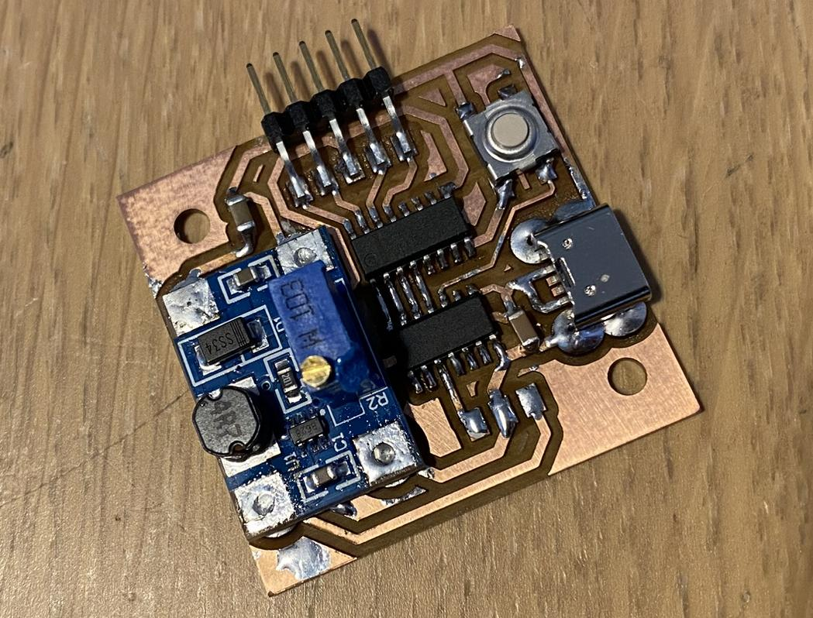
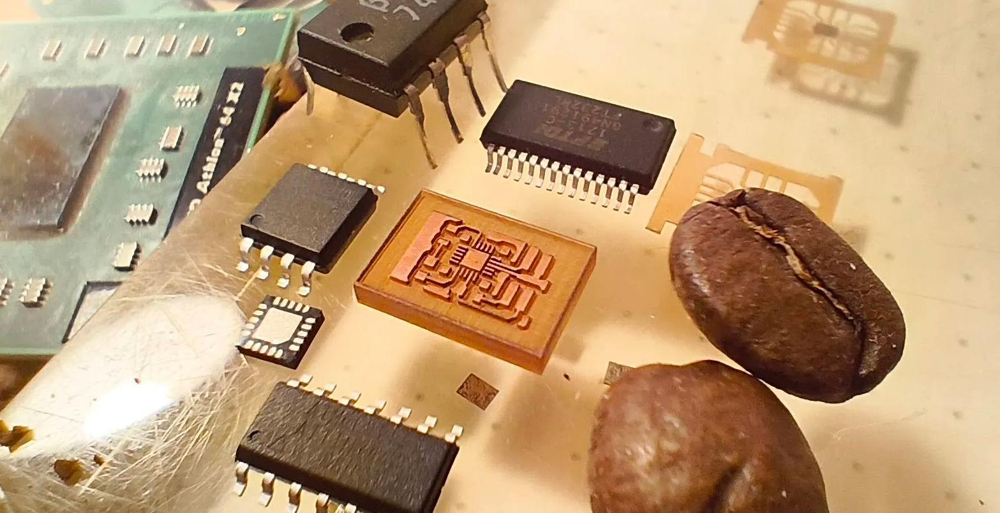

# Electronics

Electronics at Fab Lab Ísafjörður: circuit boards, microcontrollers,
programming, firmware and the tools we use for them.

This includes making PCBs on the lab's machines, programming boards, and
guides for tools that are hard to get started with.

-   

    **[UV laser PCB settings](pcb-production/uv-laser-pcb.md)**

    Making PCBs on the xTool UV laser, from Gerber files to finished board.

-   

    **[Tiny PCB on the UV laser](pcb-production/uv-laser-tiny-pcb.md)**

    An ATtiny3226 board scaled down to 6.5 mm, with traces down to 0.1 mm.

Pages are grouped by topic, for example `pcb-production/`. Images go in
`img/<page-name>/`. Have you built a board or figured out a tricky toolchain?
See [Contributing](../contributing/index.md).
