# UV laser PCB settings

**Author:** Svavar Konráðsson. See more of his work
[here](https://fabacademy.org/2023/labs/isafjordur/students/svavar-konradsson/index.html).  
**Machine:** [xTool F2 Ultra UV](../../machines/xtool/index.md)

## EasyTrace 5000

I've found that if I go into the folder with the Gerber files, take the
`F_Cu.gbr` file into Ricardo's [EasyTrace 5000](https://cam.eltryus.design/easytrace5000/)
and use the Filled Polygon option in Isolation Routing, the process takes only
half as long as when you use the PNG of the traces and ablate all the copper
with the laser.

I first select Start with Laser:

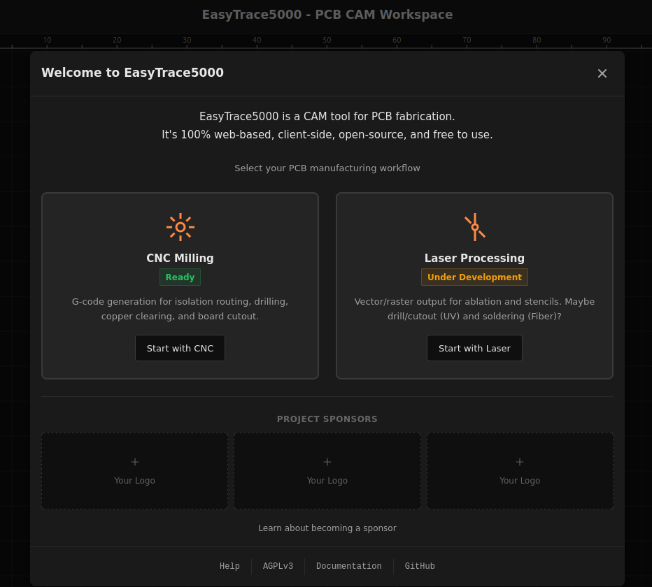

Then select UV:

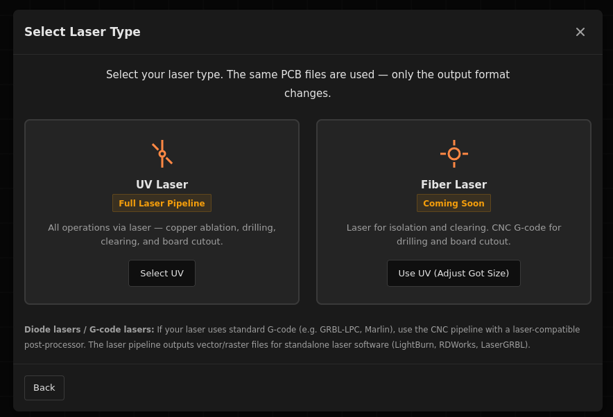

Then I drag the `F_Cu.gbr` file into Isolation Routing:

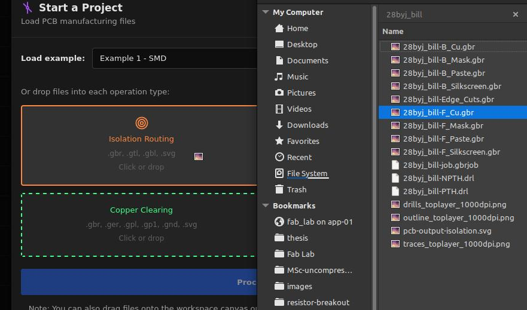

On the right, I select SVG and xTool Studio:

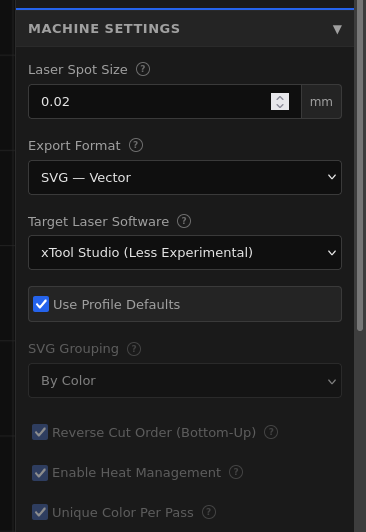

Then on the left, I select the `F_Cu.gbr` file:

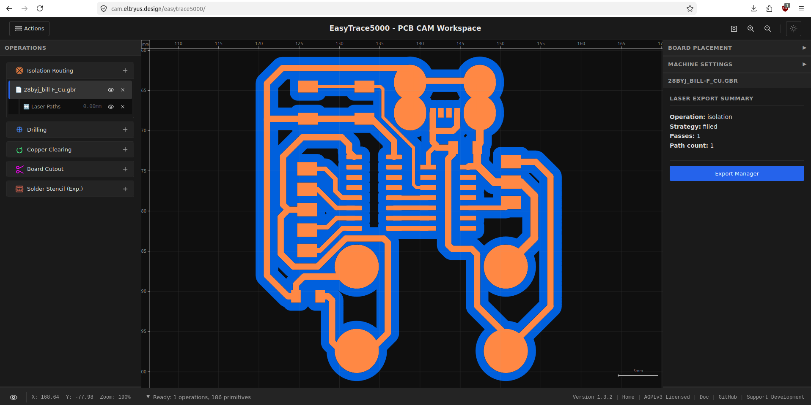

Now I get the offset settings on the right side. For this board, a 1 mm offset
worked well. I use the Filled Polygon option.

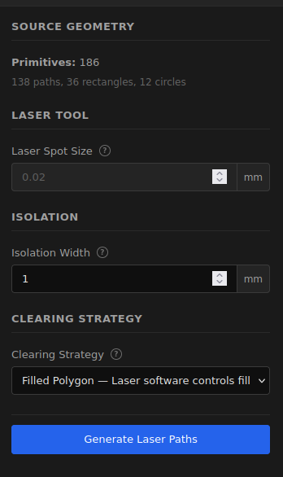

Then I hit Generate Laser Paths and export the SVG, and import the SVG into
xTool Studio.

## xTool Studio settings

I use [Gerber2PNG](https://gerber2png.fablabkerala.in/) to get the PNG files
and import them into the same project in xTool Studio. Then I use the Align
function to align them all together, and the Trace function in xTool Studio to
turn them into vectors.

Here are the settings I used for the traces:

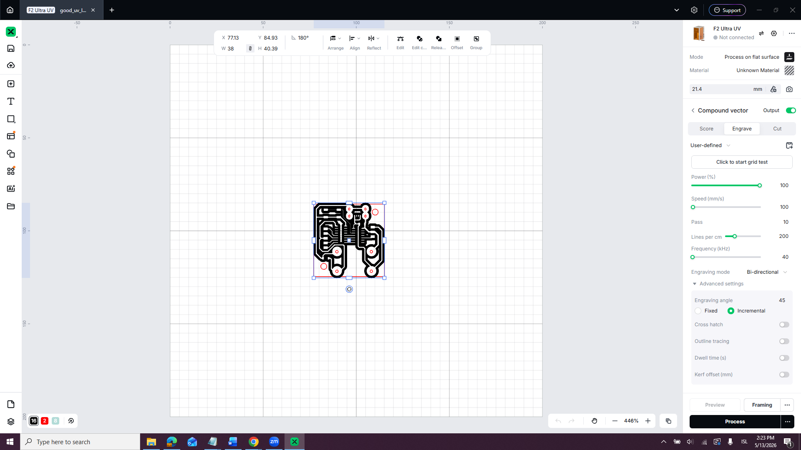

Here are the settings I used for the holes and outline:

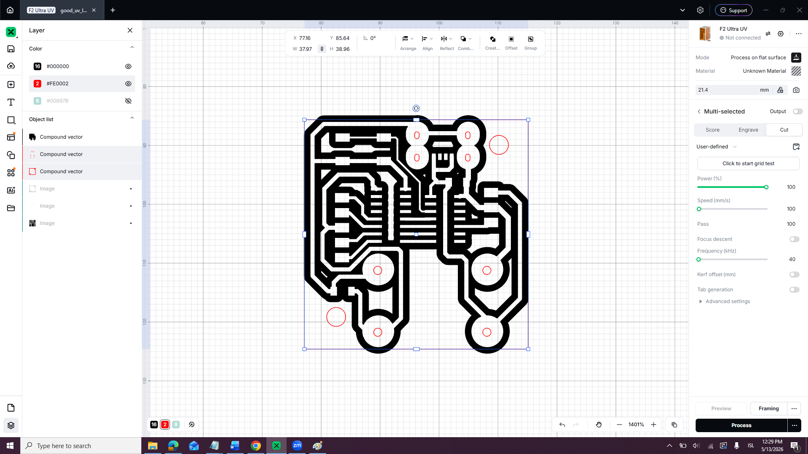

I make the different operations different colors, and then arrange the order
of operations by arranging the layers on the left.

Then I select the three dots next to the black Process. Under Processing path
(which means order of operations) I select User defining, and check By layer:

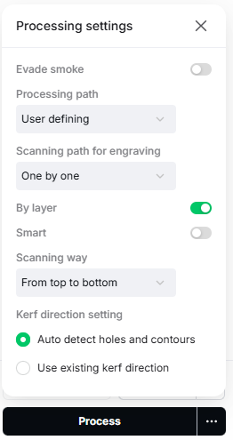

[:lucide-download: Good UV settings, xTool .xcs file](../img/uv-laser-pcb/xtool/good_uv_laser_settings.xcs){ .md-button }

## Outcome

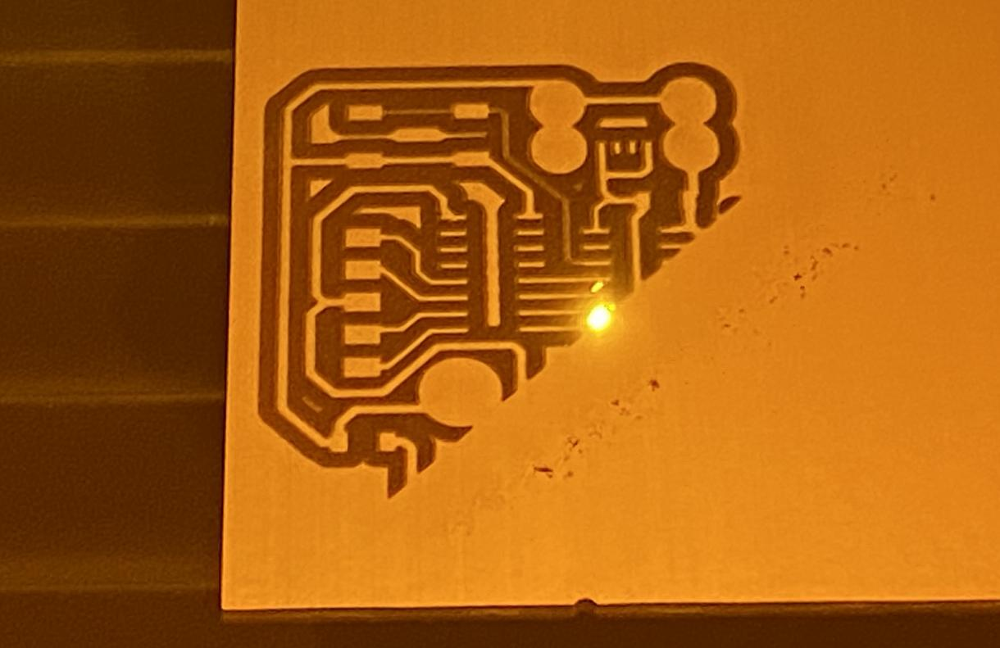

I've found that the flatness of the PCB stock matters a lot. When it curves, I
get inconsistent results, like this:

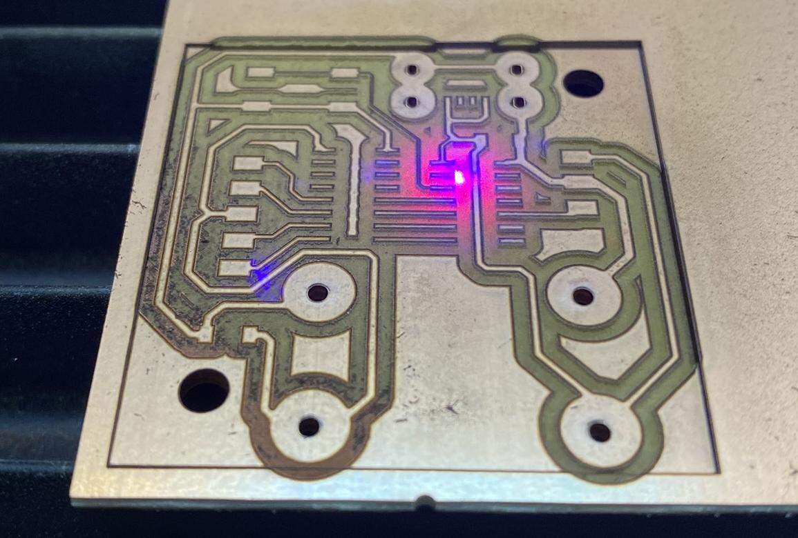

This was after 8 passes. After 2 more passes, all the copper was cleared:

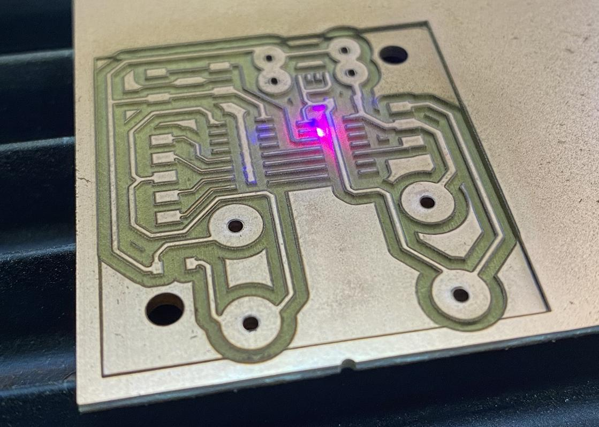

There may be a little debris, oxidation or charring on the traces after laser
processing. I think they would work fine, but to make the traces a bit nicer I
used a wet sanding sponge to clean them up:

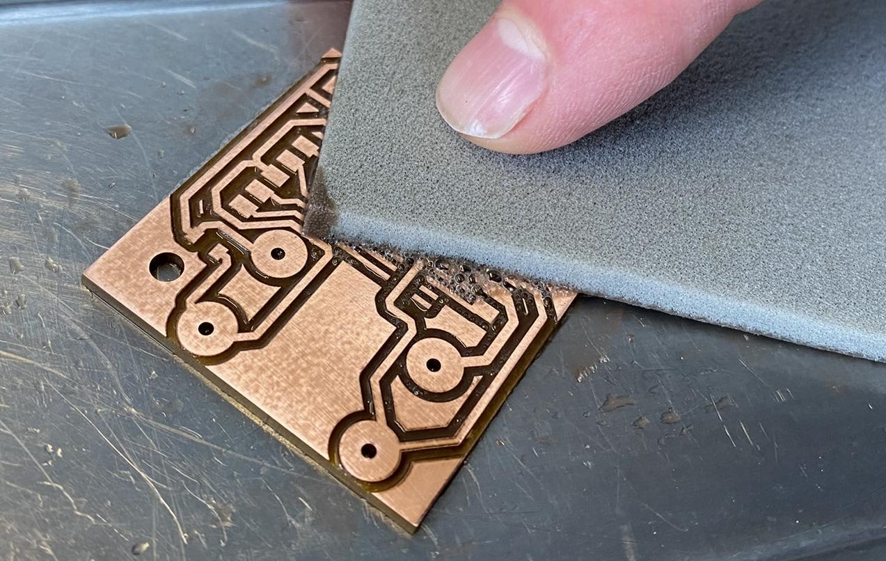

After sanding, the board looks like this:

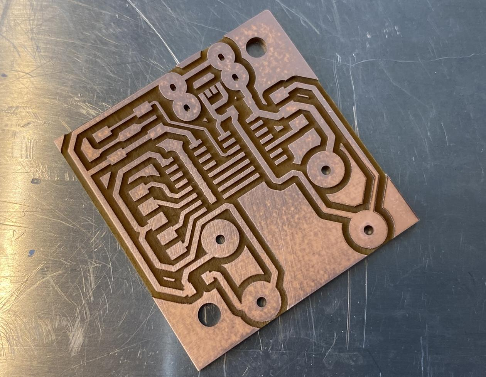

The reason for using the UV laser on this board was the fine spaces between
the pads for the power-only USB-C connector in the top right corner. I
enlarged the pads that the metal housing goes into a lot, to get a better
mechanical connection. I tore up the connector on the last USB-C board I made.

Here is the final result:

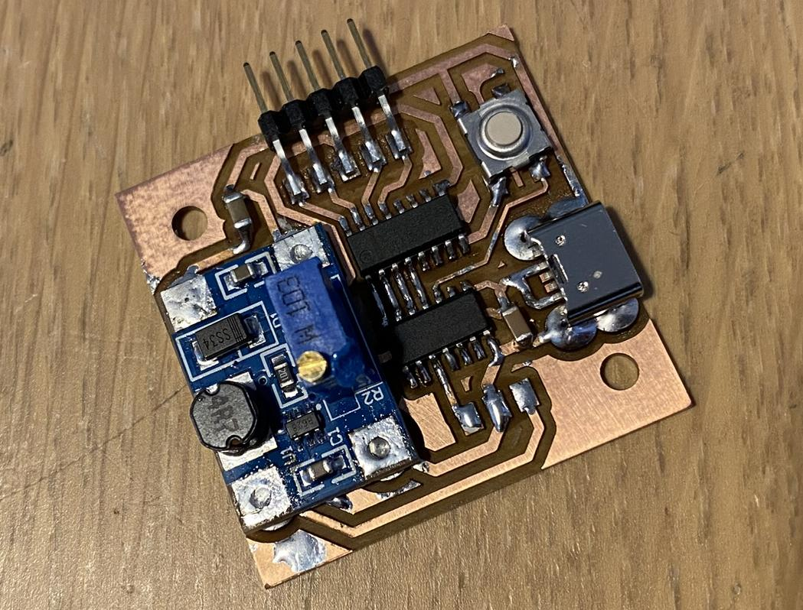

## Related documentation

- [Tiny PCB on the UV laser](uv-laser-tiny-pcb.md)
- [xTool F2 Ultra UV](../../machines/xtool/index.md)
