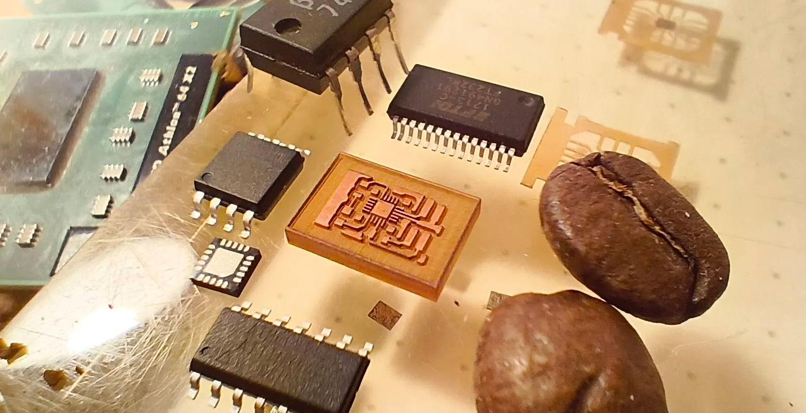
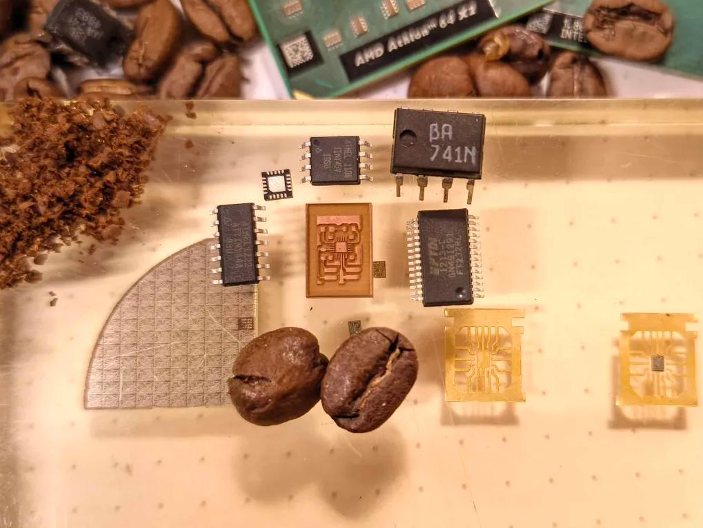
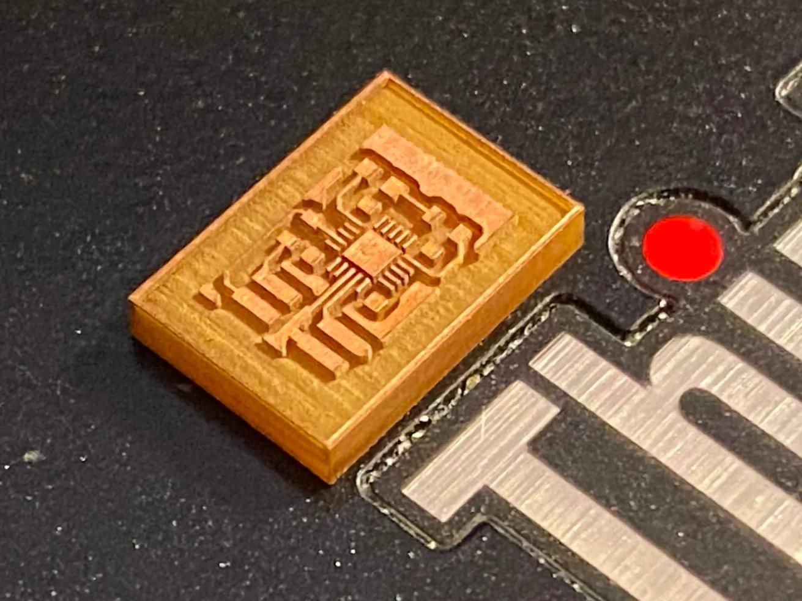
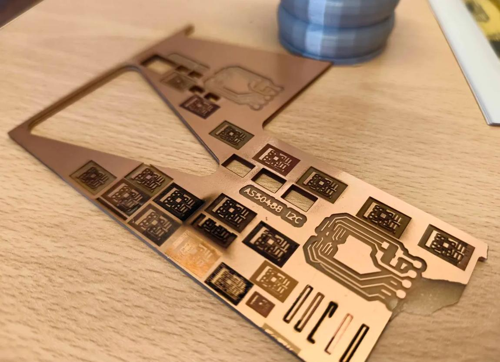
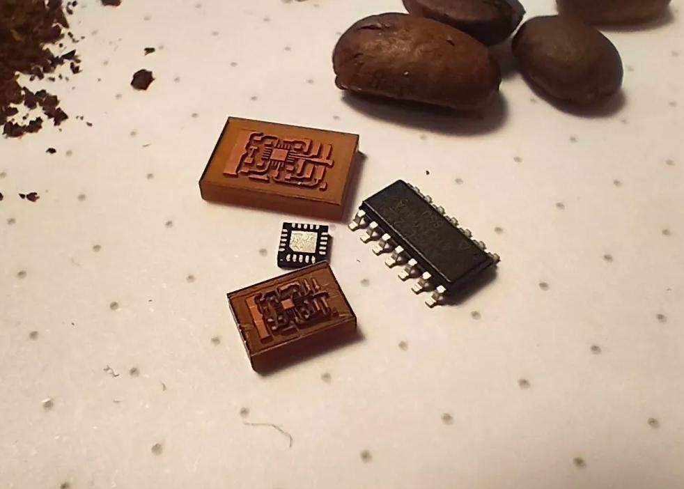
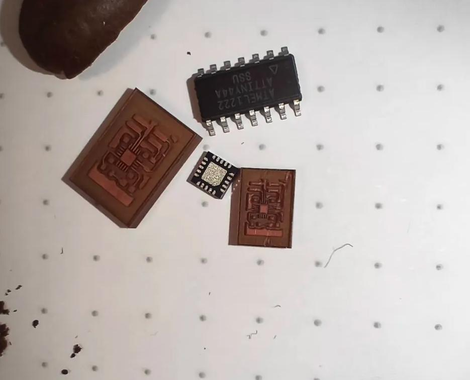
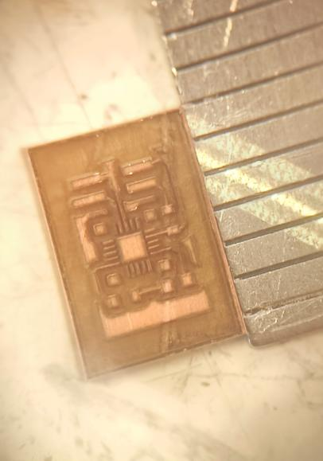
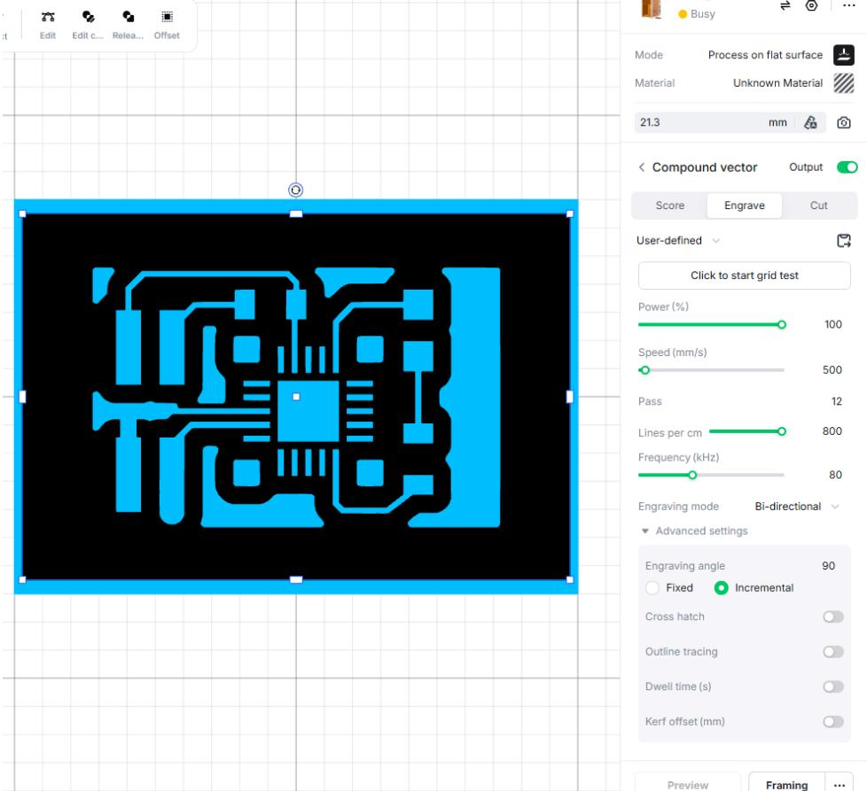
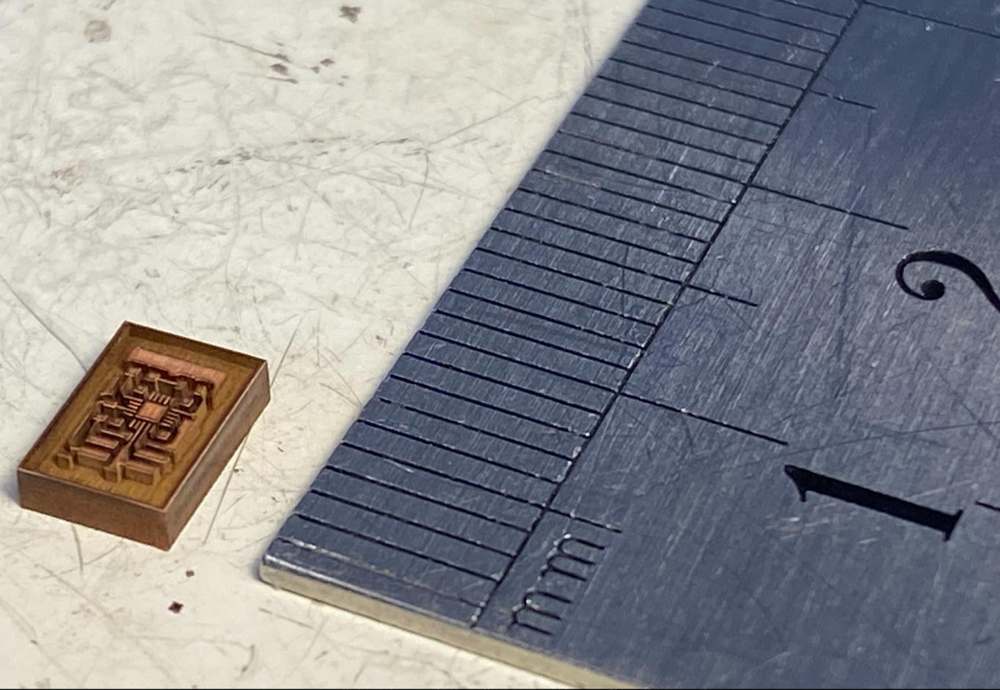

# Tiny PCB on the UV laser

**Author:** Svavar Konráðsson. See more of his work
[here](https://fabacademy.org/2023/labs/isafjordur/students/svavar-konradsson/index.html).  
**Date:** March 2026  
**Machine:** [xTool F2 Ultra UV](../../machines/xtool/index.md)

The new UV laser is giving us amazing results at
[Fab Lab Ísafjörður](https://www.fabisa.is). Trace width down to about 0.1 mm,
and it cuts the board outline without charring! This is the future of PCB
production in Fab Labs.

Neil's [hello.t3226-MU board](https://fabacademy.org/2026/classes/embedded_programming/t3226/hello.t3226-MU/hello.t3226-MU.png),
which has an ATtiny3226 in a tiny VQFN package, was scaled down for the first
test, and then *scaled down again* until its longer edge was only 6.5 mm. And
it works! The xTool project files for both runs are at the end of each
section.

The UV laser lets us use pretty much any tiny modern component, except for
most BGA (ball grid array) packages, because we can't do in-pad vias.

## First run

[:lucide-download: First run settings, set.xcs](../img/uv-laser-tiny-pcb/set.xcs){ .md-button }

## Second run

[:lucide-download: Second run settings, smaller_set.xcs](../img/uv-laser-tiny-pcb/smaller_set.xcs){ .md-button }

## Related documentation

- [UV laser PCB settings](uv-laser-pcb.md)
- [xTool F2 Ultra UV](../../machines/xtool/index.md)
