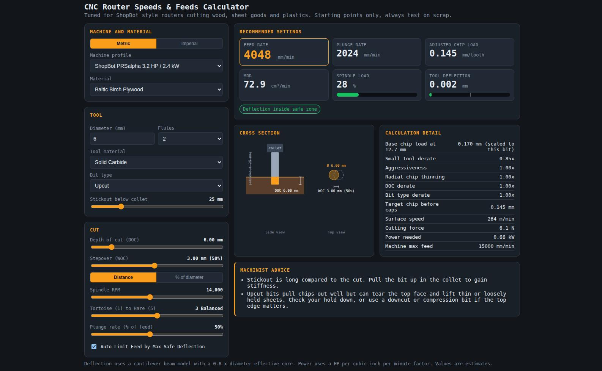
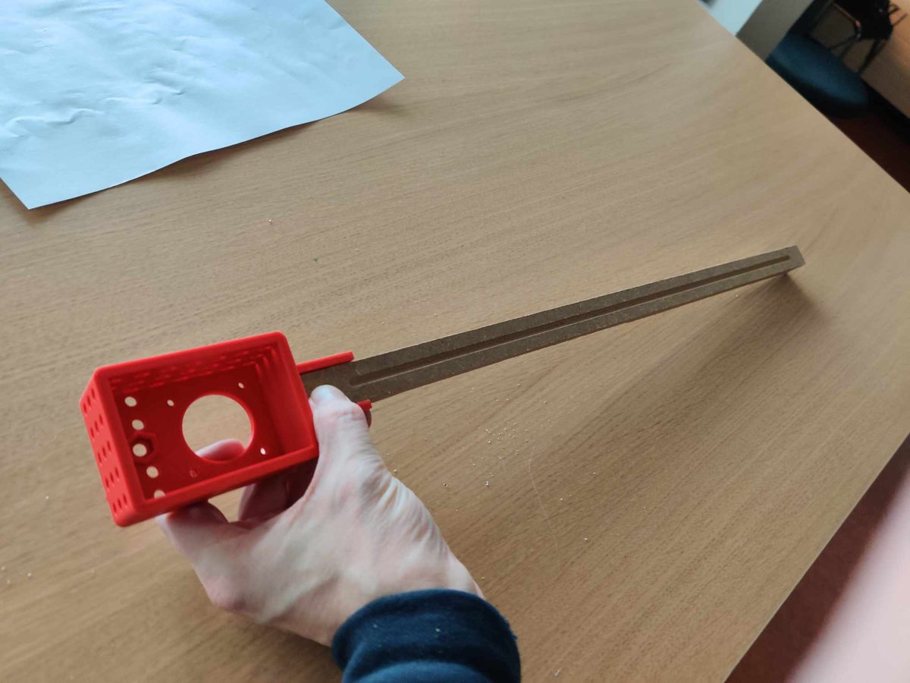

# Experiments

Experiments, tests and discoveries made at Fab Lab Ísafjörður.

This is where we document what we try, what works, what fails, and what we
learn. Failed experiments are welcome here. Knowing what didn't work saves the
next person time.

-   

    **[Speeds and feeds calculator](speeds-and-feeds.md)**

    Starting feed and plunge rates for CNC routers like the ShopBot and Carvey.

-   

    **[Beehive beam on a CNC router](machine-building/beehive-beam.md)**

    Making a long Beehive axis beam from MDF on a 3-axis CNC router.

Experiments are grouped by topic, for example `machine-building/`. Images go
in `img/<experiment-name>/`.
