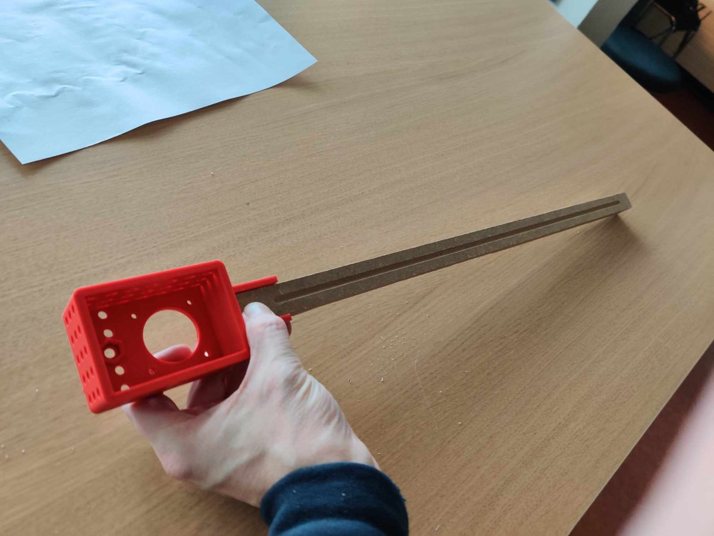
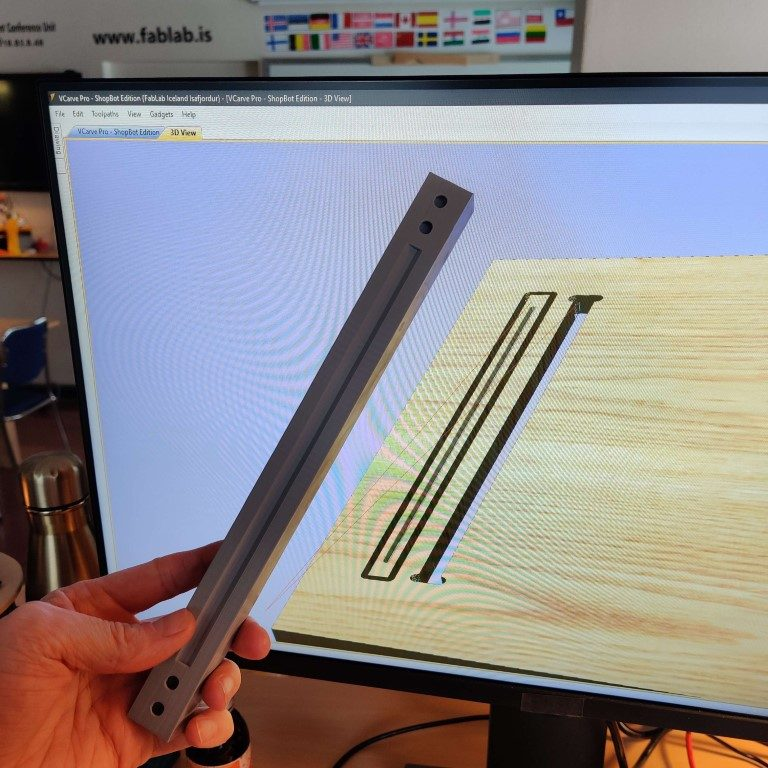
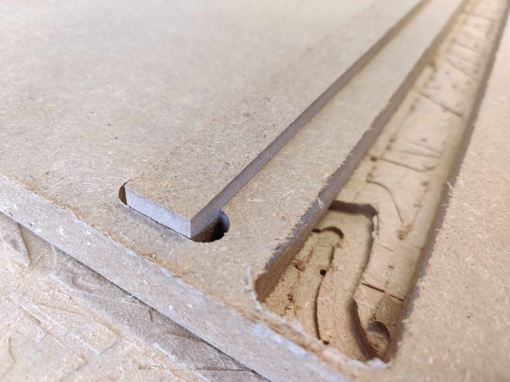
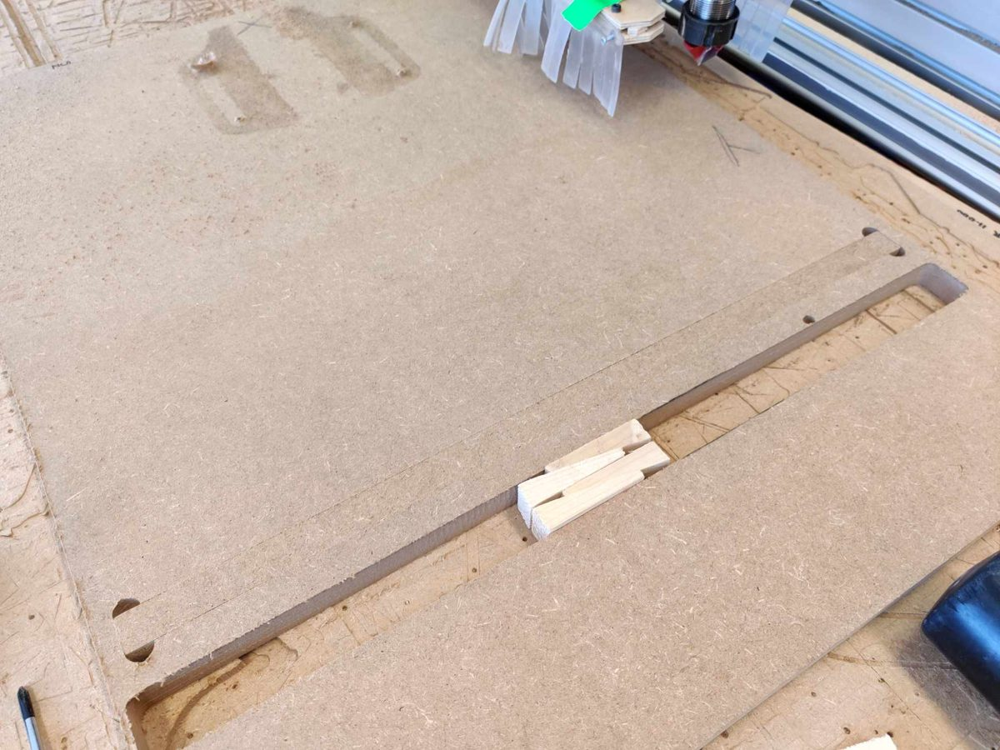
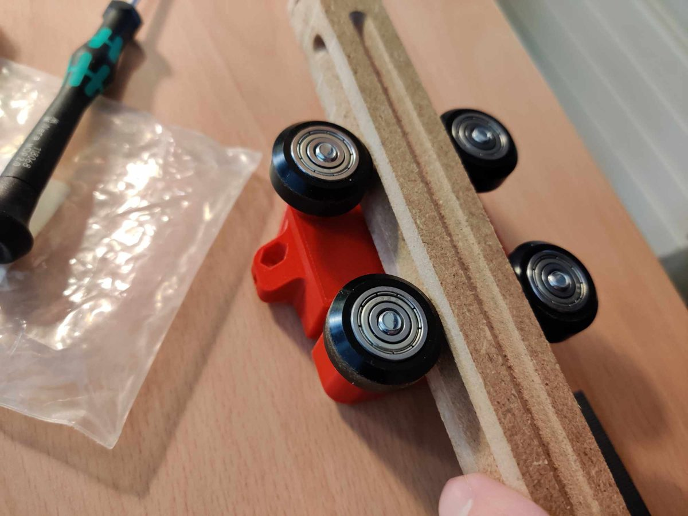
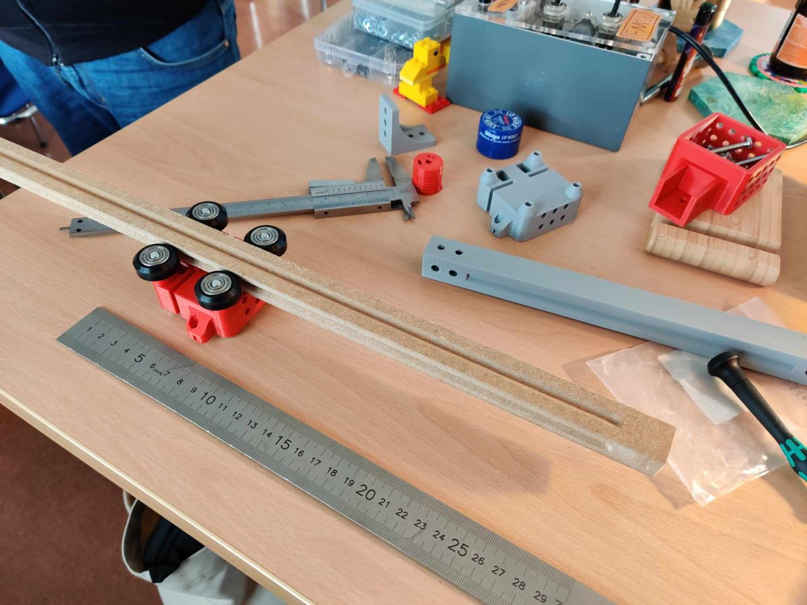
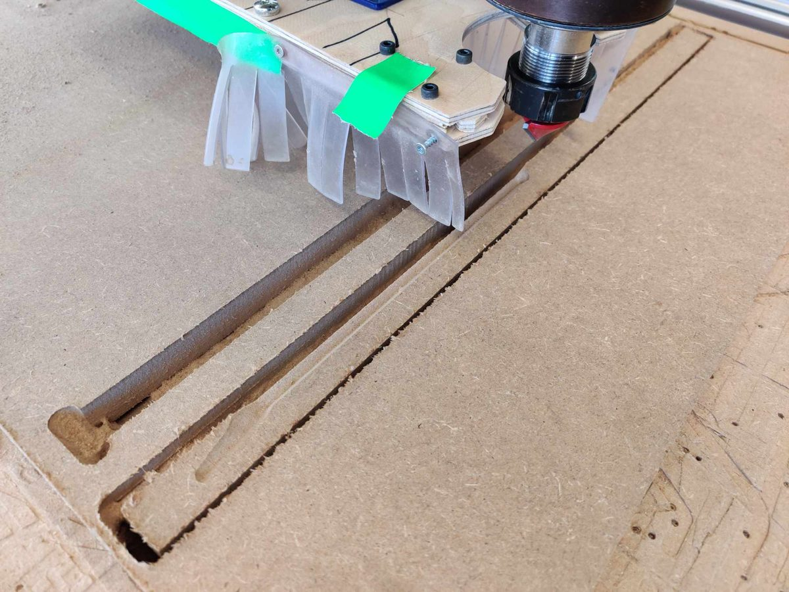

# Beehive beam on a CNC router

**Author:** Þórarinn Bjartur Breiðfjörð  
**Date:** 2023-10-13  
**Status:** Proof of concept

## Overview

Can a [Beehive](https://gitlab.cba.mit.edu/quentinbolsee/beehive-axes/-/tree/main/parts?ref_type=heads)
axis beam be made on a standard CNC router, with standard tools and common
materials? This first spiral shows that it can.

## Background

So far we've been 3D printing the beams, which limits them to about 250 mm
long on the Ultimaker printers. At the Fab Academy instructor bootcamp there
was a longer print made on a SainSmart INFI-20 belt printer, which Baken
[documented](https://academany.fabcloud.io/fabacademy/2023/instructors-bootcamp/Projects/PrintableAxis/).

We wanted to try making a long beam on a CNC router instead, with two goals:

- Use commonly available materials
- Do it on a 3-axis machine

## Materials and equipment

- **Material:** MDF. It's consistent and easy to work with.
  [Valchromat](https://www.investwood.pt/en/valchromat/) might be a good
  alternative, but it's less common and more expensive.
- **Tools:** one 6 mm end mill for the profile cut and pocket clearing, and a
  V-bit for the bearing grooves.
- **Software:** VCarve for the design and toolpaths.

!!! note "Material thickness"
    The Beehive design uses 20 mm, but MDF doesn't come in 20 mm, so we used
    19 mm. Other options are to mill thicker MDF down, or to change the
    Beehive design.

## Process

This is a proof of concept, so we used low pressure and didn't design the end
attachment.

The beam is made as a two-sided job:

1. **Job one** cuts the V-groove, cuts the profile (19 × 500 mm) and clears a
   19 × 500 mm pocket.
2. **Job two** only cuts a V-groove. The part from job one is pressed into the
   pocket so the second groove can be cut on the other side.

A 0.4 mm offset gave a good fit.

Wedges can be used to hold the part in place. In this case the fit was good,
so they weren't really needed.

## Results

It works. The beam takes the printed Beehive parts, and the fit is good.

## Observations

- One part failed because the tabs weren't strong enough.
- Precision can be improved by surfacing the spoil board on the CNC router
  before cutting.

## Future development

- Make the beam longer
- Find a solution for the end attachments

## Files and resources

- [Original repository](https://github.com/FabLabIsafjordur/Beehive_beam_cnc_router),
  including the VCarve file (`files/beam_concept_proof.crv`)
- [Beehive axes](https://gitlab.cba.mit.edu/quentinbolsee/beehive-axes/-/tree/main/parts?ref_type=heads)
- [Printable axis from the instructor bootcamp](https://academany.fabcloud.io/fabacademy/2023/instructors-bootcamp/Projects/PrintableAxis/)

## Related documentation

- [Speeds and feeds calculator](../speeds-and-feeds.md)
