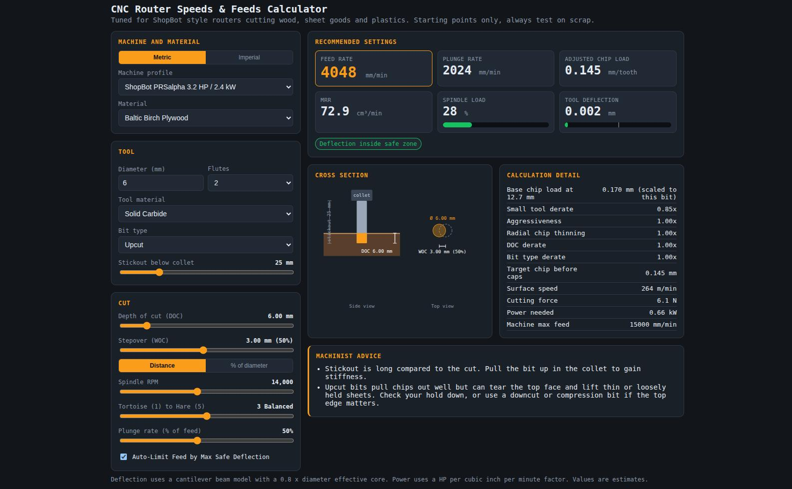

# Speeds and feeds calculator

A calculator for ShopBot style CNC routers cutting wood, sheet goods and plastics. You pick the machine, material, bit and cut, and it gives you a feed rate and plunge rate to start from.

[Open the calculator](cnc-calculator/index.html){ .md-button .md-button--primary target=_blank }



!!! warning "Starting points only"
    The numbers are estimates. Testing on scrap for the first cut is recomended, then adjust by watching the chips and listening to the cut.

## How it works

The calculator starts from one idea: **chip load**. That is how thick a chip each cutting edge (flute) takes per turn of the bit. Too thin and the bit rubs instead of cutting, which makes heat and dulls it. Too thick and the bit bends, the cut gets rough, or the bit breaks.

It works out a good chip load for your setup, then turns that into a feed rate:

```
feed rate = chip load × number of flutes × RPM
```

After that it checks two limits and slows the feed down if needed:

1. **The machine's top speed.** The feed can't go above what the machine can do.
2. **How much the bit bends.** If the cut would bend the bit more than the allowed amount, the feed is lowered until it doesn't (when *Auto-Limit Feed* is on).

## Inputs

### Machine and material

| Input | What it does |
|---|---|
| **Metric / Imperial** | Switches all lengths and feeds between mm and inches. |
| **Machine profile** | Sets the max feed, spindle power and how stiff the machine is. A stiffer machine gets a little more chip load and less deflection. |
| **Material** | Sets the starting chip load, how hard the material is to cut, and how much power it takes. |

### Tool

| Input | What it does |
|---|---|
| **Diameter** | Bit diameter. Bigger bits can take a bigger chip and bend less. |
| **Flutes** | Number of cutting edges. More flutes means a faster feed for the same chip load, but less room for chips to get out. |
| **Tool material** | Solid carbide or HSS. HSS gets 20% less chip load and bends more. |
| **Bit type** | Upcut, downcut or compression. Changes the advice and slows downcut bits in deep cuts. |
| **Stickout below collet** | How far the bit sticks out of the collet. This matters a lot for bending. Twice the stickout means about 8 times the deflection, so keep it as short as you can. |

### Cut

| Input | What it does |
|---|---|
| **Depth of cut (DOC)** | How deep each pass goes. |
| **Stepover (WOC)** | How wide each pass is, as a distance or as a % of the bit diameter. A full slot is 100%. |
| **Spindle RPM** | Spindle speed. Higher RPM means a faster feed for the same chip load. |
| **Tortoise (1) to Hare (5)** | How hard to push. 1 is careful, 3 is normal, 5 is aggressive. It changes the chip load and how much bending is allowed. |
| **Plunge rate** | Plunge feed as a % of the cutting feed. |
| **Auto-Limit Feed by Max Safe Deflection** | When on, the feed is lowered if the bit would bend too much. Leave this on unless you know why you are turning it off. |

## Results

| Result | What it means |
|---|---|
| **Feed rate** | The cutting feed to put in your toolpath. This is the main number. |
| **Plunge rate** | Feed for going straight down into the material. |
| **Adjusted chip load** | The real chip load at the final feed rate, after any limits. If this is below about 0.05 mm per tooth the bit is rubbing. |
| **MRR** | Material removal rate, how much material is cut away per minute. Useful for comparing settings. Higher MRR means the job finishes faster. |
| **Spindle load** | How much of the spindle's power the cut needs. The bar turns yellow past 80% and red past 100%. |
| **Tool deflection** | How much the bit bends sideways during the cut. The white mark on the bar is the allowed limit for the slider setting you picked. |

The colored **badges** under the results tell you what limited the feed or what to watch out for. The **Machinist advice** box gives notes for your exact setup, like a long stickout, a cut that is too deep for one pass, or a compression bit used too shallow.

## The chip load adjustments

The **Calculation detail** table shows each step. They are all multiplied together to get the target chip load.

| Step | What it does |
|---|---|
| **Base chip load** | The material's chip load for a 12.7 mm (1/2") bit, scaled down for smaller bits. A 6 mm bit gets about half. |
| **Small tool derate** | Small bits snap easily. Bits 3.2 mm and under get 0.75x, bits up to 6.35 mm get 0.85x. |
| **Tool material** | Carbide is 1x, HSS is 0.8x. |
| **Machine rigidity** | Stiffer machines can take a bit more. The PRSalpha is 1x, the Carvey is 0.9x. |
| **Aggressiveness** | From the tortoise and hare slider, 0.6x to 1.3x. |
| **Radial chip thinning** | With a stepover under 50%, the chips come out thinner than the feed suggests, so the calculator feeds faster to make up for it (up to 2x). At 50% or more stepover this is 1x. |
| **DOC derate** | Cuts deeper than one bit diameter pack chips and load the bit, so the chip load drops about 17.5% for each extra diameter of depth. |
| **Bit type derate** | Downcut bits push chips down into the slot. Past 1x diameter deep they get 0.9x, past 2x they get 0.8x. |

## Example

With the default settings (ShopBot PRSalpha, Baltic Birch, 6 mm 2 flute carbide upcut, 25 mm stickout, 6 mm deep, 3 mm stepover, 14,000 RPM, slider on 3):

- Chip load comes out at about **0.145 mm per tooth**
- Feed rate is 0.145 × 2 × 14,000 ≈ **4,050 mm/min**
- Spindle load is under 30% and deflection is far below the limit, so nothing slows it down

## Using it with the Carvey

Pick **Inventables Carvey 300 W** as the machine profile.

- **Always set the RPM slider to 12,000.** The Carvey's spindle tops out at 12,000 RPM, and the feed rate is only right if the RPM matches what the machine really does. The advice box will remind you if it's set higher.
- The spindle is small (300 W), so keep an eye on the spindle load bar and take light passes.
- The max feed in the profile is an estimate. The real limit is in gSender under the machine settings (`$110` and `$111`, in mm/min).

## Tips

- If the chips are dust, the chip load is too low. Raise the feed or lower the RPM.
- If the cut is loud, rough or the bit gets hot, back off the slider or take a lighter pass.
- A steady, crisp sound usually means you are close.
- Shorter stickout is the easiest way to get a faster and cleaner cut.

## Source code

The calculator is plain HTML, CSS and JavaScript. No build step and no libraries, so you can open `index.html` straight from disk and it works.

The files live in this repo under [`docs/experiments/cnc-calculator/`](https://github.com/FabLabIsafjordur/docs/tree/main/docs/experiments/cnc-calculator).

```
cnc-calculator/
├── index.html       page layout, inputs and result boxes
├── css/
│   └── style.css    all the styling
└── js/
    ├── data.js      machines, materials and tuning numbers
    ├── format.js    unit conversion and number formatting
    ├── calc.js      the speeds and feeds math
    ├── advice.js    the badges and machinist advice notes
    ├── diagram.js   the cross section drawing
    ├── ui.js        reads the inputs and shows the results
    └── main.js      starts everything
```

The scripts are loaded in that order in `index.html`, and each file uses the ones loaded before it. They all share one global object called `CNC` instead of using imports. That is what lets the page run straight from disk.

### Where to change things

| To change...                                         | Edit                                           |
| ---------------------------------------------------- | ---------------------------------------------- |
| Add a machine or material, or fix their numbers      | `data.js`, in `MACHINES` or `MATERIALS`        |
| The tortoise and hare levels or the derating factors | `data.js`, in `AGGRESSIVENESS` or `TUNING`     |
| The default values when the page loads               | `data.js`, in `DEFAULT_STATE`                  |
| How the feed rate is worked out                      | `calc.js`                                      |
| Add a warning or advice note                         | `advice.js`, in `badgesFor()` or `adviceFor()` |
| Rows in the calculation detail table                 | `ui.js`, in `renderDetailTable()`              |

Most changes only need `data.js`. All the math works in millimeters, and only the display switches to inches.
