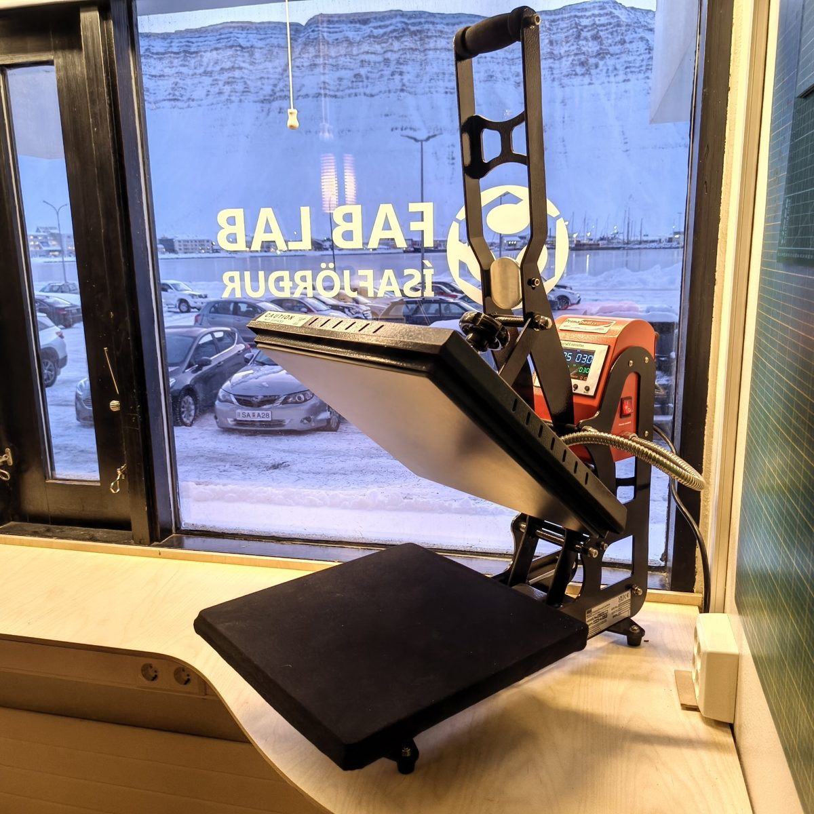

# Heat press

## Overview

A clam style heat press for transferring vinyl and sublimation prints onto
t-shirts, bags and other flat items.

Set the temperature and time on the digital controller, then close the press
with the handle.

!!! warning "Hot surface"
    The top plate gets very hot. Keep your hands clear while it's heating and
    when you open it.

## Specifications

| Specification     | Value                                   |
| ----------------- | --------------------------------------- |
| Manufacturer      | Prima Group Carlisle                    |
| Model             | PPMC 38                                 |
| Machine type      | Clam heat press                         |
| Power             | 220 V, 8.2 A, 50/60 Hz                  |
| Year              | 2023                                    |

## Documentation

Settings for common materials and instructions will be added here.

## Resources

- [The Prima Group](https://www.theprimagroup.co.uk/)
- [Roland CAMM-1 GX-24](../roland-camm/index.md) for cutting heat transfer vinyl
