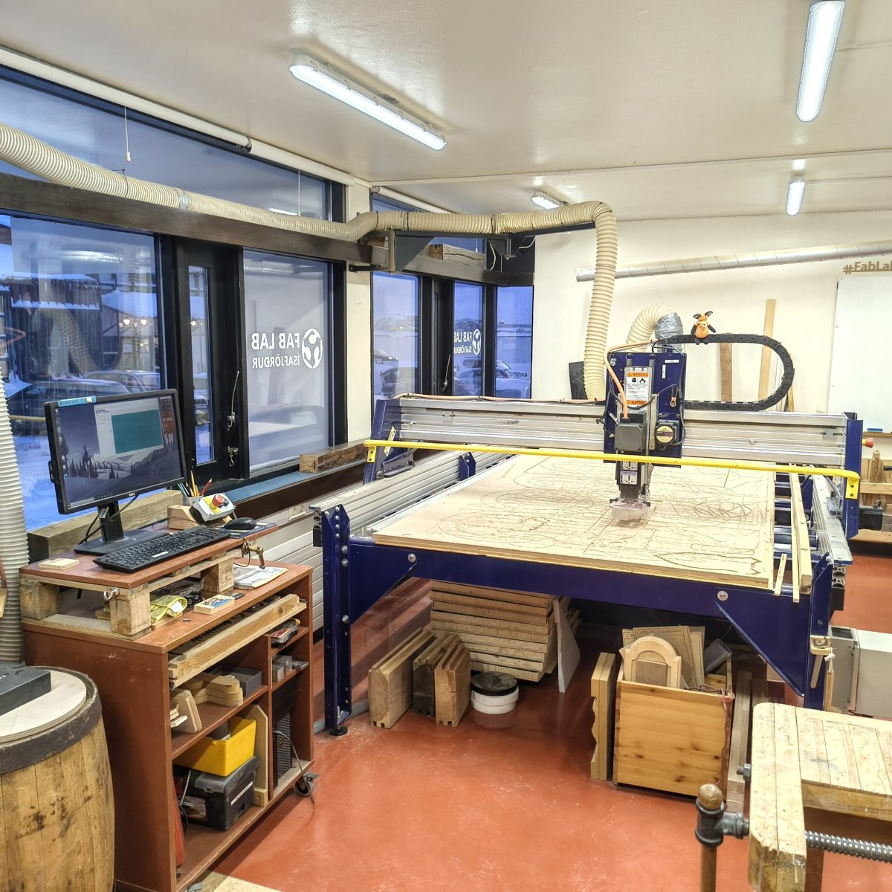
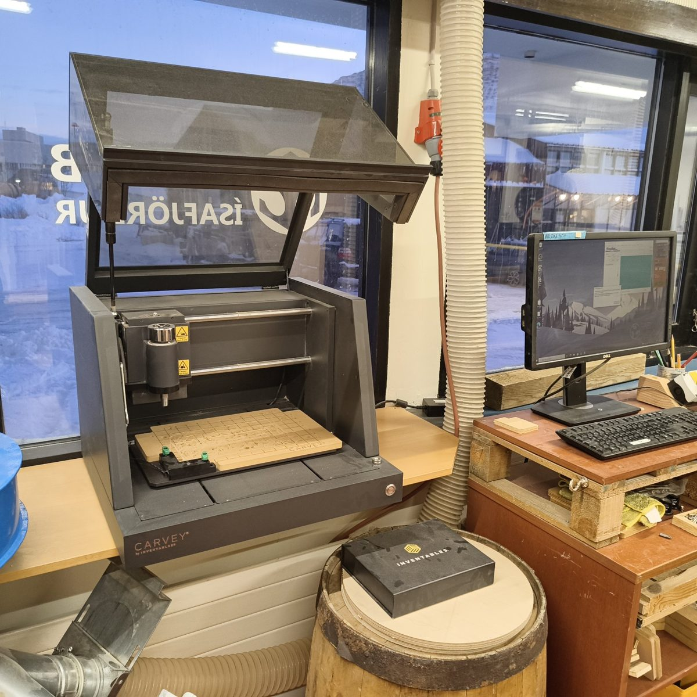
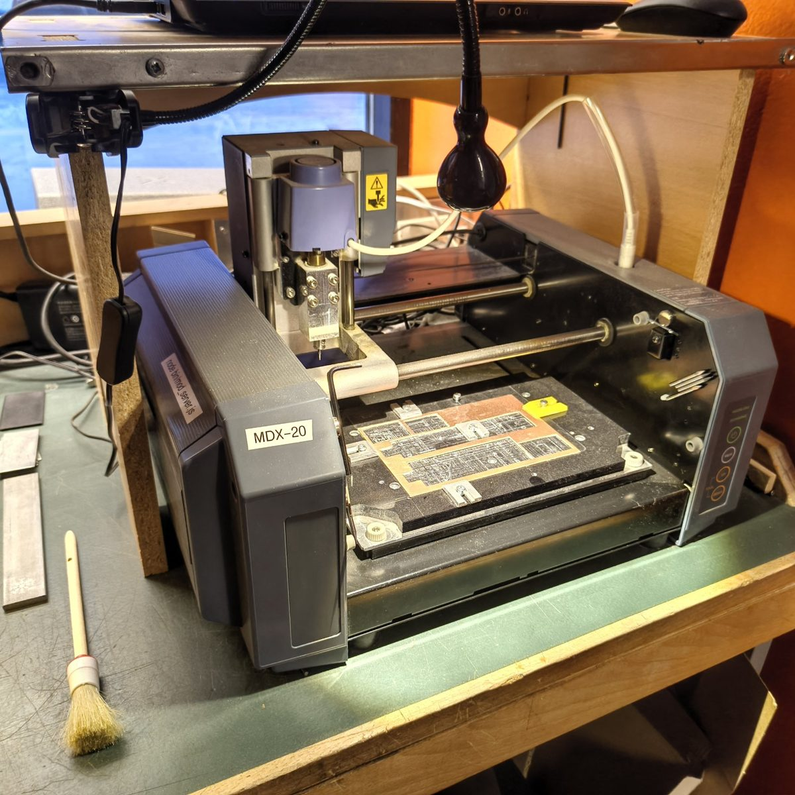
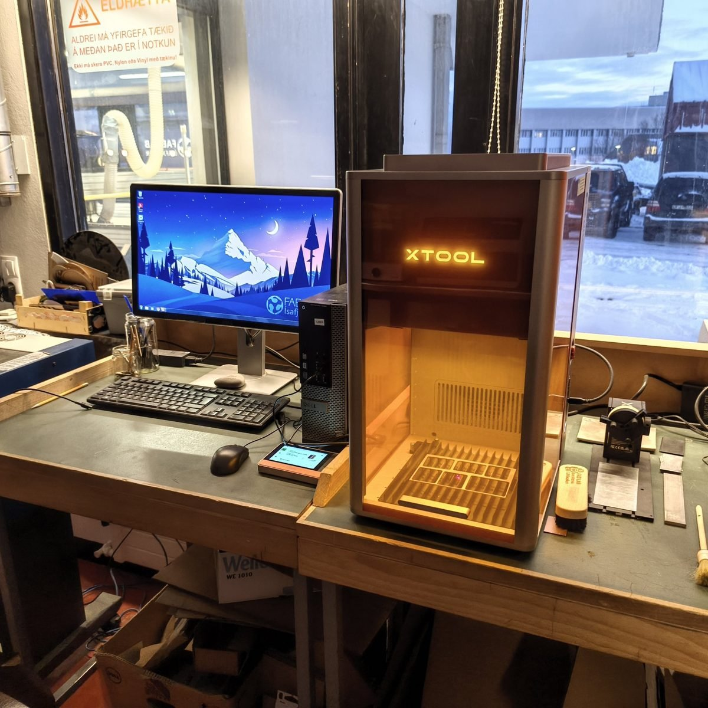
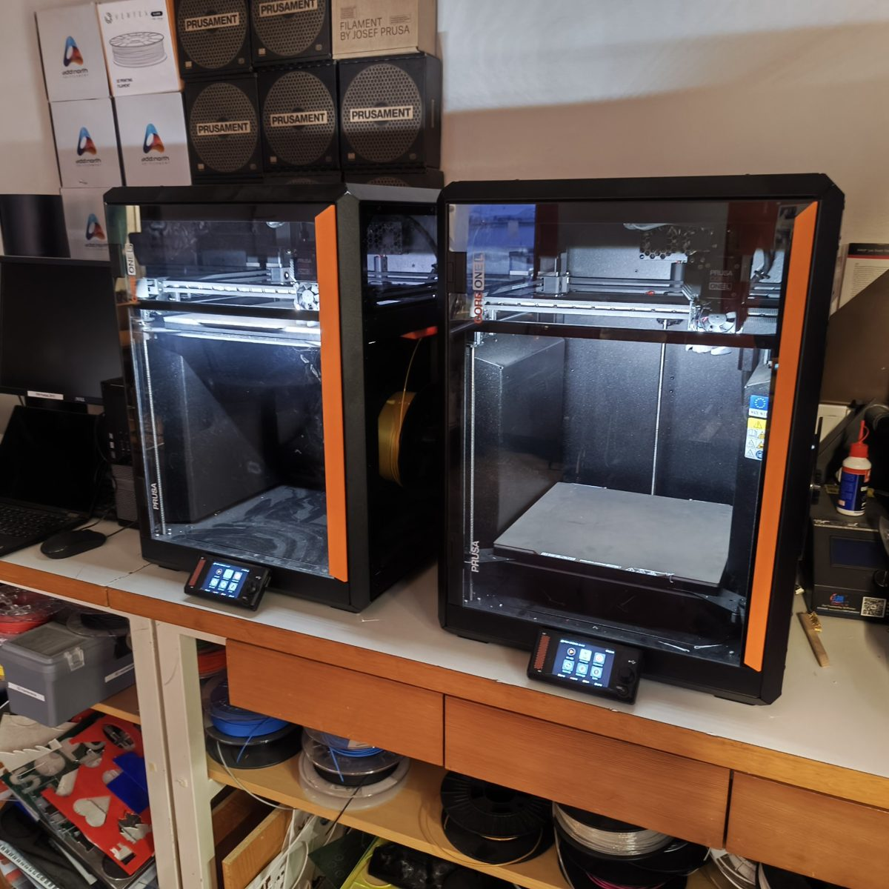
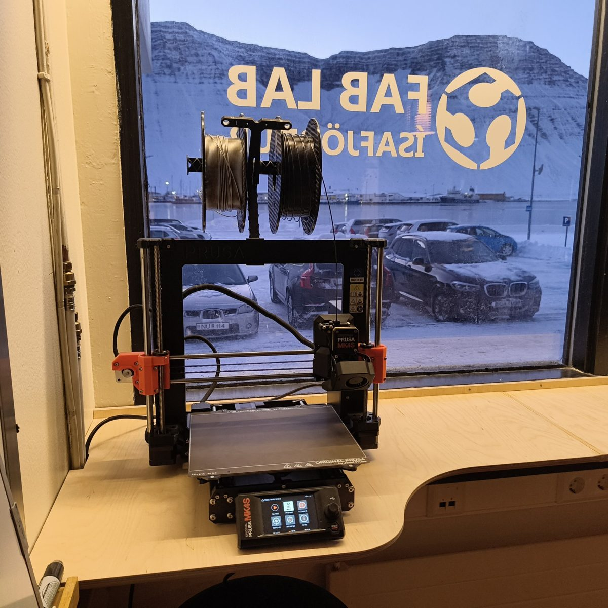
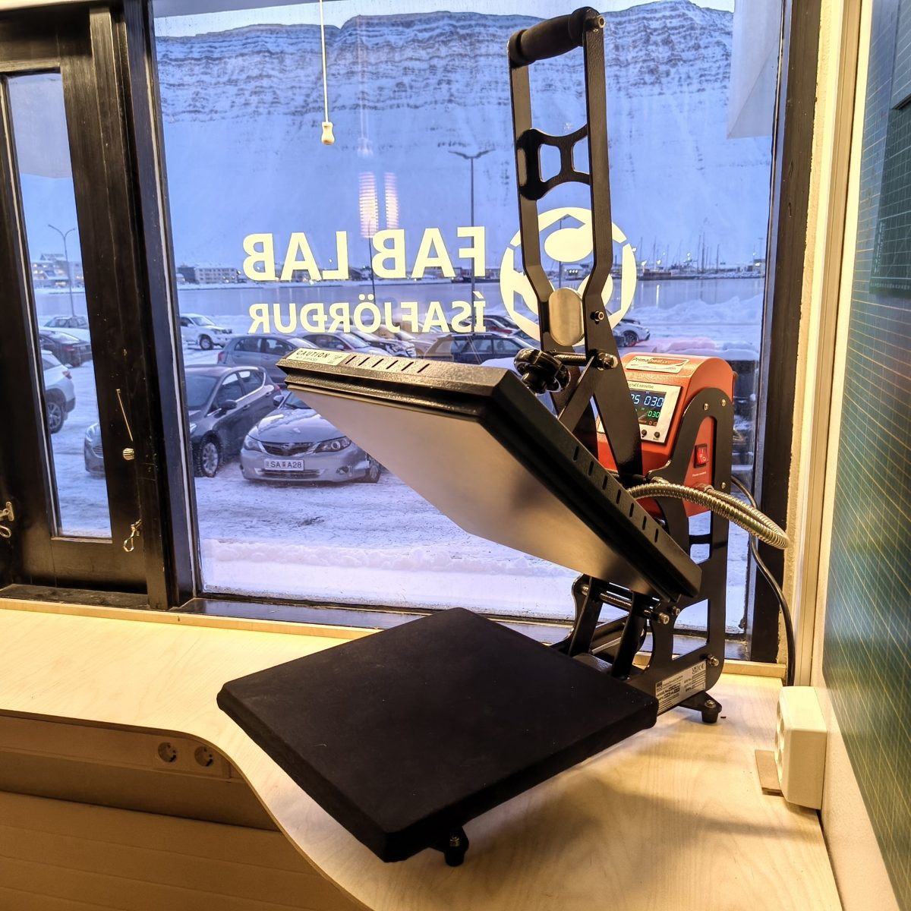
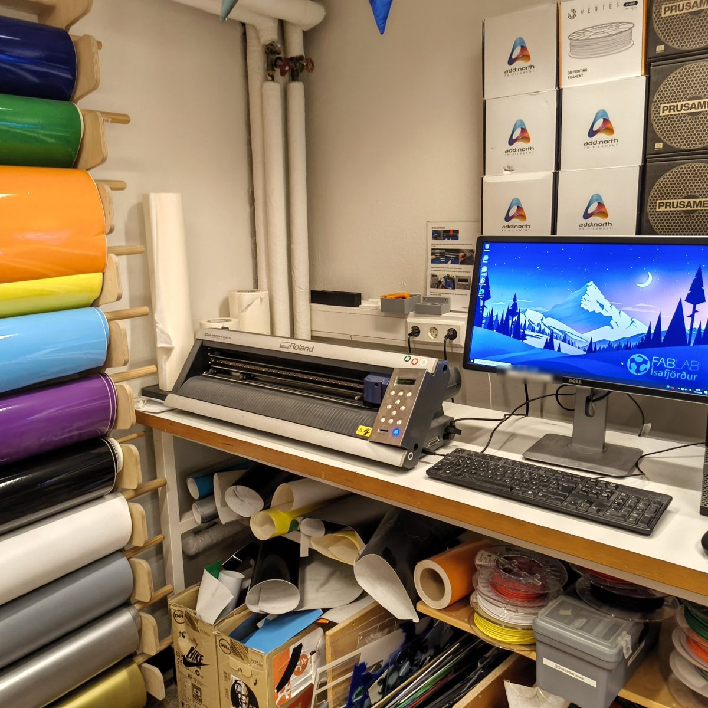

# Machines

Documentation for the machines at Fab Lab Ísafjörður: how to use them,
settings that work, maintenance, and repairs we've done.

Each machine has its own page with specifications and links to more detailed
guides.

## CNC milling

-   

    **[ShopBot](shopbot/index.md)**

    Large CNC router for sheet material.

-   

    **[Carvey](carvey/index.md)**

    Enclosed desktop CNC mill for small parts in wood, plastic and soft metals.

-   

    **[Roland MDX-20](mdx-20/index.md)**

    Small precision mill, mainly for milling circuit boards.

## Laser cutting and engraving

-   

    **[Epilog Mini 24](epilog-mini/index.md)**

    CO₂ laser cutter and engraver.

-   

    **[xTool F2 Ultra UV](xtool/index.md)**

    UV laser for fine engraving on glass, crystal and plastics.

## 3D printing

-   

    **[Prusa CORE One L](prusa-core-one-l/index.md)**

    Two large enclosed printers with a heated chamber.

-   

    **[Prusa MK4S](prusa-mk4s/index.md)**

    Everyday open-frame printer for PLA, PETG and TPU.

## Vinyl and textiles

-   

    **[Heat press](heat-press/index.md)**

    Clam heat press for vinyl and sublimation transfers.

-   

    **[Roland CAMM-1 GX-24](roland-camm/index.md)**

    Vinyl cutter for stickers, heat transfer vinyl and copper film.

## Not documented yet

The Precious Plastic machines don't have pages here yet. See the full
[equipment list on fabisa.is](https://www.fabisa.is/búnadur/taeki).

Want to document one of them? See [Contributing](../contributing/index.md).
