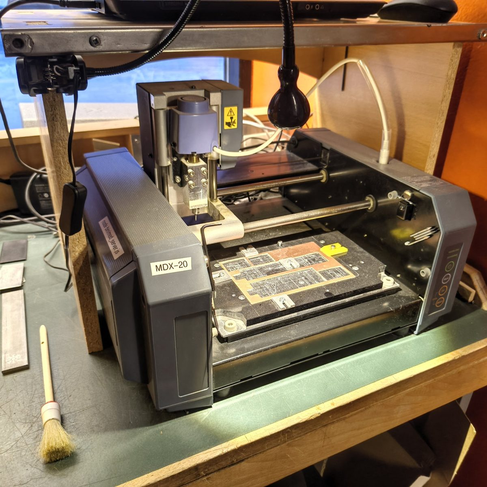

# Roland MDX-20

## Overview

The Roland Modela MDX-20 is a small, precise desktop milling machine. At the
lab it's mainly used for milling circuit boards from single-sided copper
boards, a standard part of the Fab Academy electronics weeks.

It's controlled from [mods](https://modsproject.org/), which turns PCB images
into toolpaths and sends them to the machine.

## Specifications

| Specification     | Value                                |
| ----------------- | ------------------------------------ |
| Manufacturer      | Roland DG                            |
| Model             | Modela MDX-20                        |
| Machine type      | Desktop milling machine              |
| Working area      | 203 × 152 × 60.5 mm                  |
| Spindle speed     | 6,500 rpm                            |
| Resolution        | 0.00625 mm/step (mechanical)         |
| Control software  | mods                                 |

## Capabilities

- PCB milling (traces and outlines)
- Small 2.5D and 3D milling in soft materials like wax and foam

## Documentation

Operating instructions and guides will be added here.

## Resources

- [mods project](https://modsproject.org/)
- [Roland Modela at MIT Fab](https://fab.cba.mit.edu/content/tools/roland_modela/index.html)
