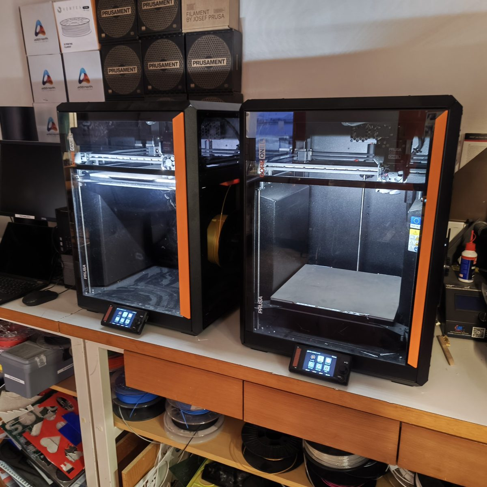

# Prusa CORE One L

## Overview

The lab has two Prusa CORE One L printers. They're enclosed CoreXY FDM
printers with a large build volume and a heated chamber, which makes them
good for big parts and for materials that warp, like ABS and ASA.

## Specifications

| Specification     | Value                                       |
| ----------------- | ------------------------------------------- |
| Manufacturer      | Prusa Research                              |
| Model             | CORE One L                                  |
| Number in lab     | 2                                           |
| Machine type      | Enclosed CoreXY FDM 3D printer              |
| Build volume      | 300 × 300 × 330 mm                          |
| Heated chamber    | Up to 60 °C                                 |
| Filament          | 1.75 mm                                     |
| Layer height      | 0.05–0.30 mm                                |
| Materials         | PLA, PETG, TPU, ABS, ASA, PC and more       |
| Software          | PrusaSlicer                                 |

## Documentation

Operating instructions and guides will be added here.

## Resources

- [Prusa CORE One L product page](https://www.prusa3d.com/p/core-one-l/)
- [Prusa Knowledge Base](https://help.prusa3d.com/)
- [PrusaSlicer](https://www.prusa3d.com/page/prusaslicer_424/)
