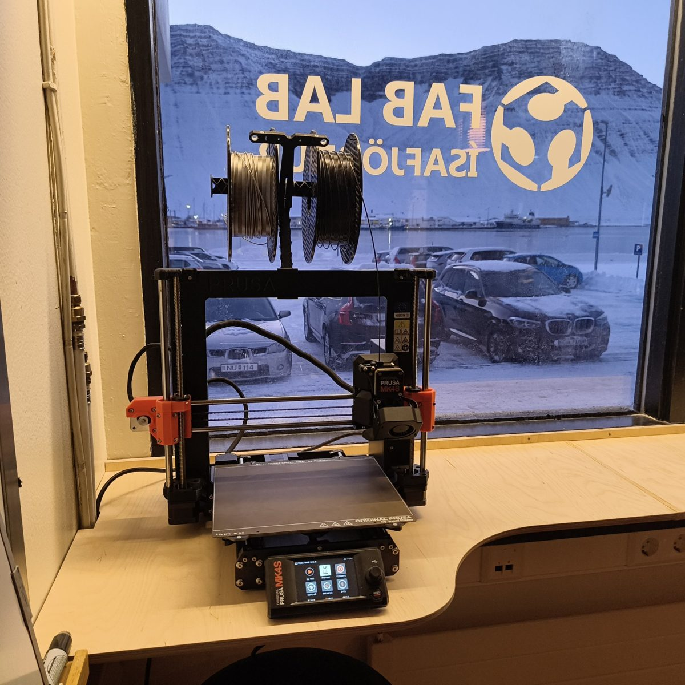

# Prusa MK4S

## Overview

The Original Prusa MK4S is an open-frame FDM 3D printer from Prusa Research.
It's a good everyday printer for functional parts and prototypes in PLA,
PETG and TPU.

It calibrates the first layer automatically with a load cell in the nozzle,
so there's no manual bed levelling.

## Specifications

| Specification     | Value                                  |
| ----------------- | -------------------------------------- |
| Manufacturer      | Prusa Research                         |
| Model             | Original Prusa MK4S                    |
| Machine type      | FDM 3D printer, open frame             |
| Build volume      | 250 × 210 × 220 mm                     |
| Filament          | 1.75 mm                                |
| Nozzle            | 0.4 mm (swappable)                     |
| Layer height      | 0.05–0.30 mm                           |
| Materials         | PLA, PETG, TPU and more                |
| Software          | PrusaSlicer                            |
| Connection        | USB drive, Wi-Fi, Ethernet             |

## Documentation

Operating instructions and guides will be added here.

## Resources

- [Prusa Research](https://www.prusa3d.com/)
- [Prusa Knowledge Base](https://help.prusa3d.com/)
- [PrusaSlicer](https://www.prusa3d.com/page/prusaslicer_424/)
