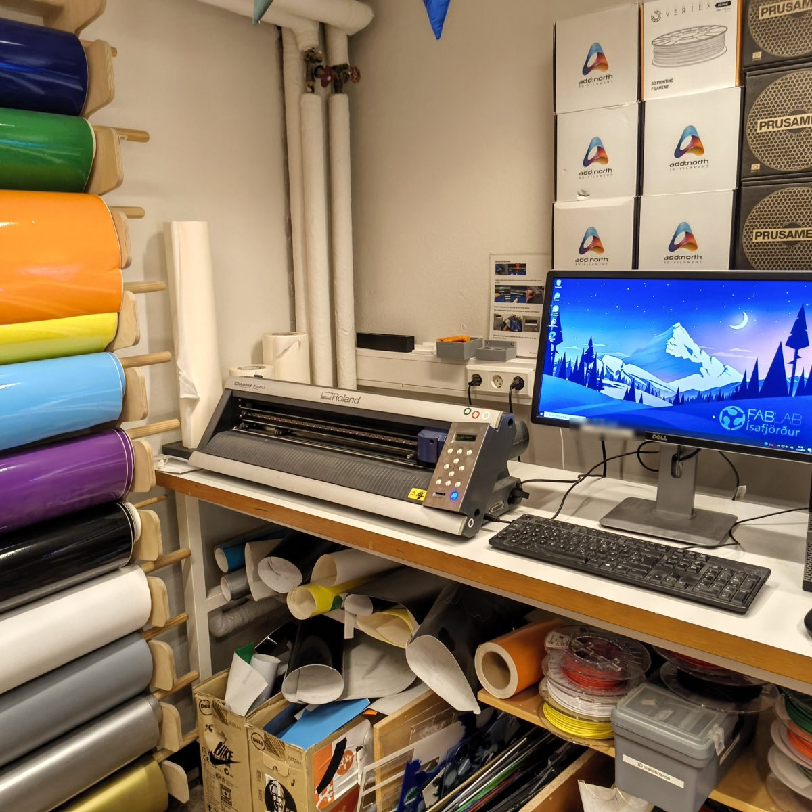
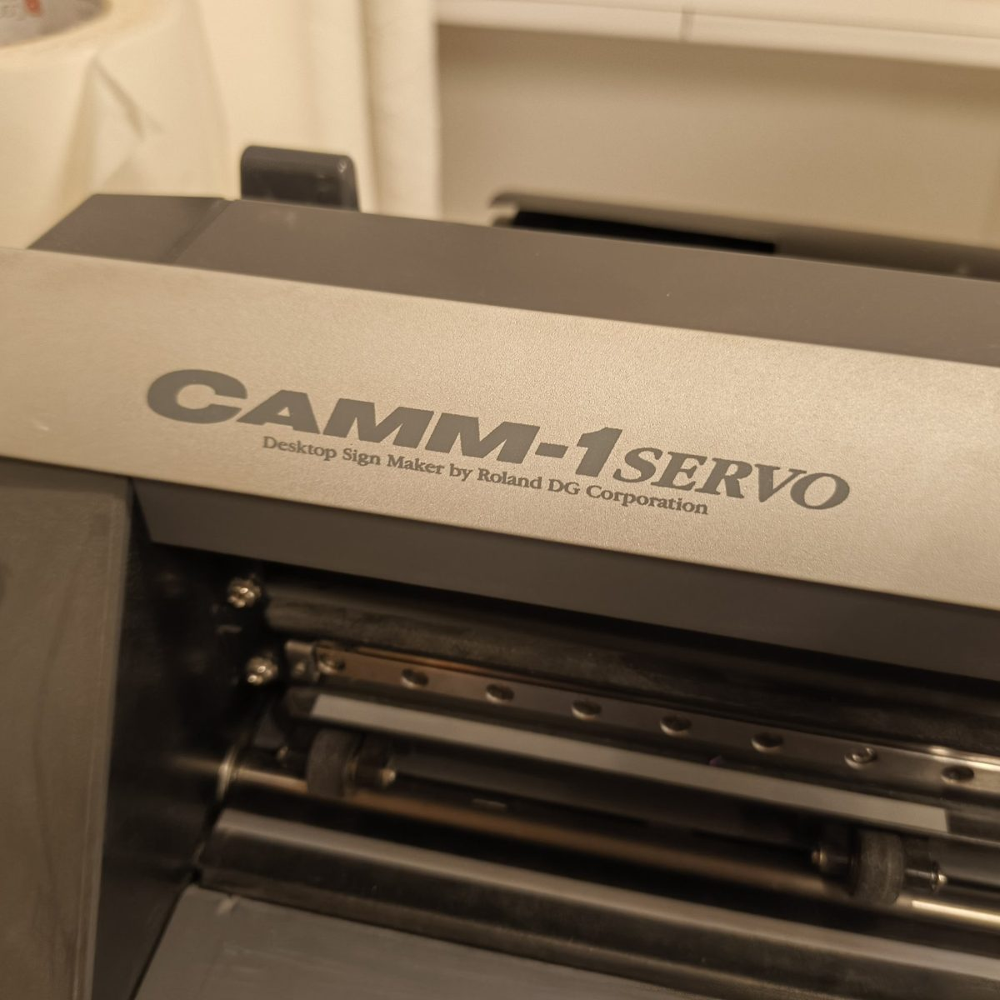

# Roland CAMM-1 GX-24

## Overview

The Roland CAMM-1 Servo GX-24 is a desktop vinyl cutter. It cuts with a small
drag knife, so it cuts thin sheet materials from a roll or a sheet without
cutting through the backing.

At the lab we use it for vinyl stickers and signs, copper film for flexible
circuits, and heat transfer vinyl for the
[heat press](../heat-press/index.md).

!!! warning "Moving parts"
    Keep your hands away from the cutting head and the rollers while the
    machine is running.

## Specifications

| Specification      | Value                                         |
| ------------------ | --------------------------------------------- |
| Manufacturer       | Roland DG                                     |
| Model              | CAMM-1 Servo GX-24                            |
| Machine type       | Desktop vinyl cutter                          |
| Material width     | 50–700 mm                                     |
| Cutting width      | 584 mm max (about 57 cm with our 60 cm rolls) |
| Cutting speed      | 10–500 mm/s                                   |
| Blade force        | 30–250 gf                                     |
| Blade              | Roland CAMM-1 series blade                    |

{ width="400" }

## Materials

| Material              | Use                                       |
| --------------------- | ----------------------------------------- |
| Vinyl                 | Stickers, signs, stencils                 |
| Heat transfer vinyl   | T-shirts and bags, with the heat press    |
| Copper film           | Flexible circuits                         |

The lab's vinyl rolls are 60 cm wide.

## Documentation

Operating instructions and guides will be added here.

## Resources

- [Roland DG](https://www.rolanddg.com/)
- [Heat press](../heat-press/index.md)
