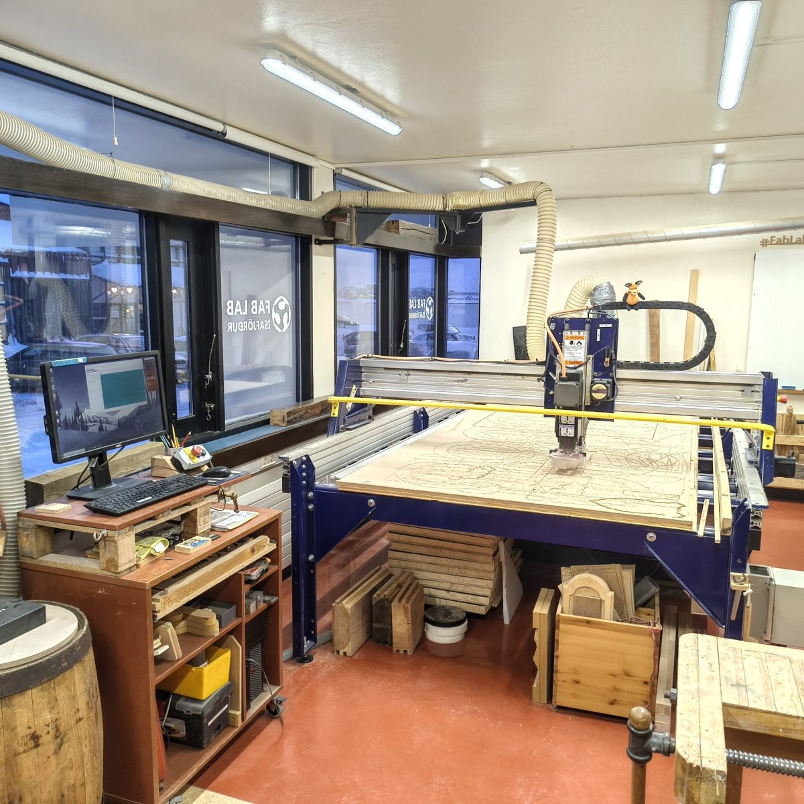

# ShopBot

## Overview

The ShopBot is a CNC milling machine used for cutting, milling, and engraving materials
using computer-controlled toolpaths.

It is primarily used for larger fabrication projects,
including furniture, structures, signs, and prototypes.

This page provides general information about the machine
and links to operating instructions, maintenance records,
and technical documentation.

## Specifications

| Specification    | Value                    |
| ---------------- | ------------------------ |
| Manufacturer     | ShopBot Tools            |
| Model            | PRS-alpha                |
| Machine type     | CNC router               |
| Working area     | 1440 x 2190 x 150 mm     |
| Spindle          | missing info             |
| Control software | ShopBot Control Software |

## Capabilities

- 2D cutting and profiling
- 2.5D milling
- Engraving
- Pocketing and drilling
- 3D relief milling

## Documentation

Operating instructions and technical guides for the
machine will be added here.

- Getting started
- Operation
- Materials and settings
- Maintenance

## Repairs and modifications

Records of repairs, replacement parts, upgrades,
and modifications made to the machine.

## Resources

- [ShopBot Tools](https://www.shopbottools.com/)
- [ShopBot Documentation](https://www.shopbottools.com/support)
