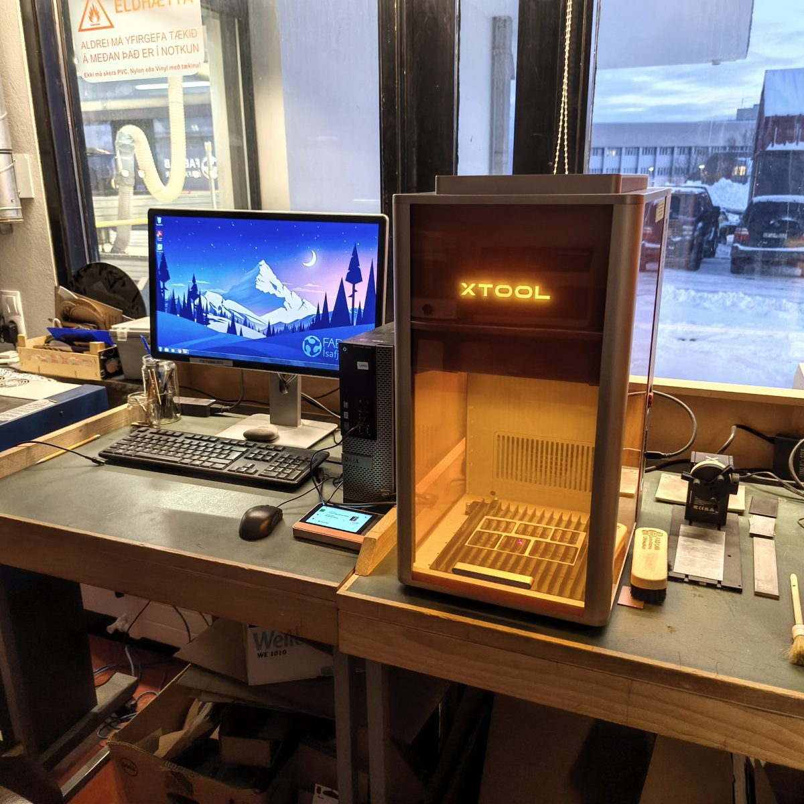

# xTool F2 Ultra UV

## Overview

The xTool F2 Ultra UV is an enclosed galvo laser with a 5 W UV laser. UV
light marks materials with very little heat, so it can engrave fine detail on
glass, crystal, plastics and other materials that a CO₂ laser would burn or
crack. It can also engrave inside clear glass and crystal.

It doesn't cut metal.

## Specifications

| Specification        | Value                                  |
| -------------------- | -------------------------------------- |
| Manufacturer         | xTool                                  |
| Model                | F2 Ultra UV                            |
| Machine type         | Enclosed galvo laser engraver          |
| Laser                | 5 W, 355 nm UV                         |
| Engraving area       | 200 × 200 mm                           |
| Inner engraving area | 70 × 70 mm                             |
| Cameras              | Two built-in cameras for positioning   |
| Software             | xTool Studio                           |

## Capabilities

- Fine surface engraving on glass, crystal, plastic, ceramic, wood and more
- Engraving inside clear glass and crystal
- Cutting thin materials

## Documentation

Operating instructions and guides will be added here.

## Resources

- [xTool F2 Ultra UV user guide](https://support.xtool.com/article/2595)
- [xTool](https://www.xtool.com/)
