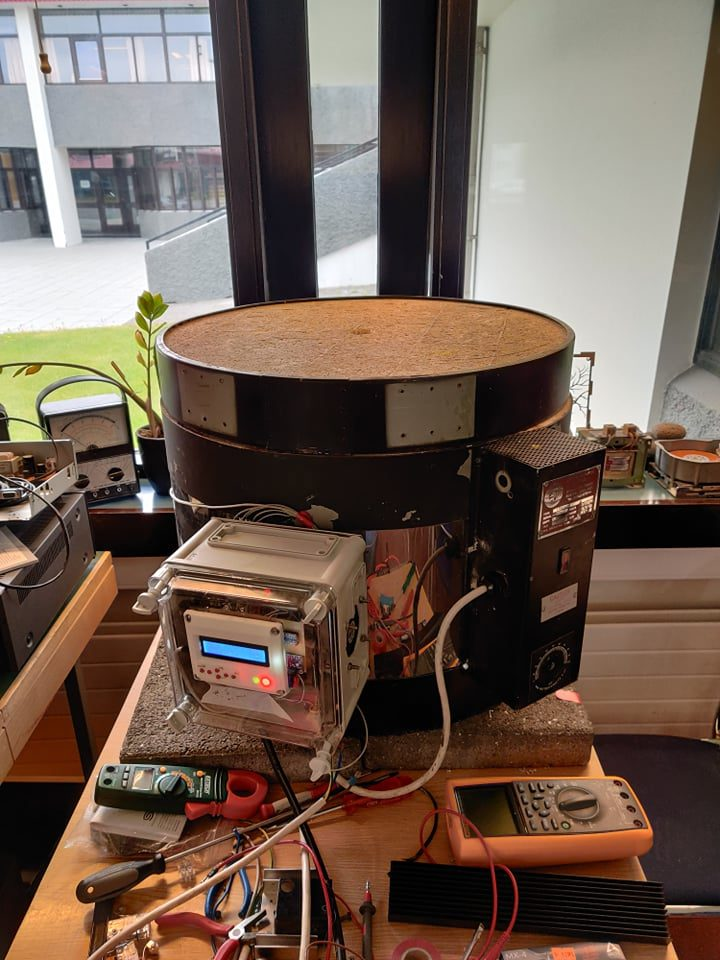

# Projects

Things designed, built or repaired at Fab Lab Ísafjörður, from tools for the
lab itself to projects with schools and the community.

Each project page covers the idea, the design, how it was made, and what we
learned.

-   

    **[Ceramic kiln controller](lab-equipment/kiln-controller.md)**

    A new Arduino based controller for an old ceramic kiln.

Projects are grouped by topic, for example `lab-equipment/`. Images go in
`img/<project-name>/`. Start from the project template in the
[repository](https://github.com/FabLabIsafjordur/docs/tree/main/templates).
