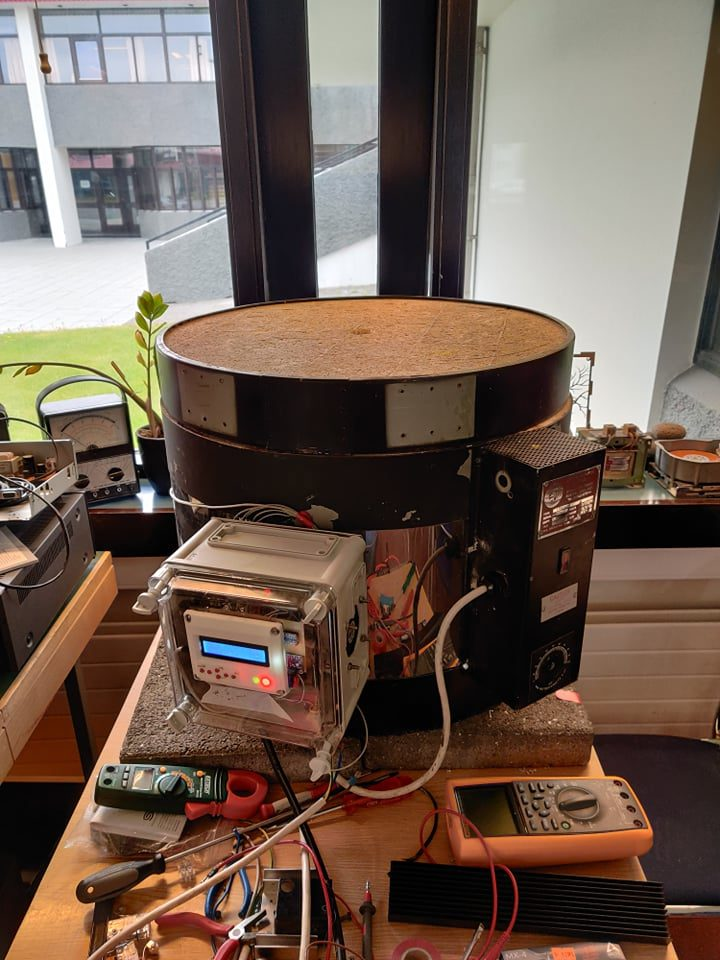
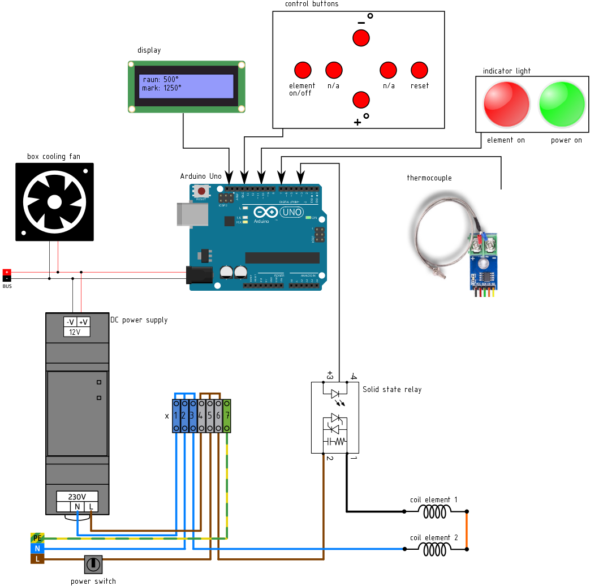
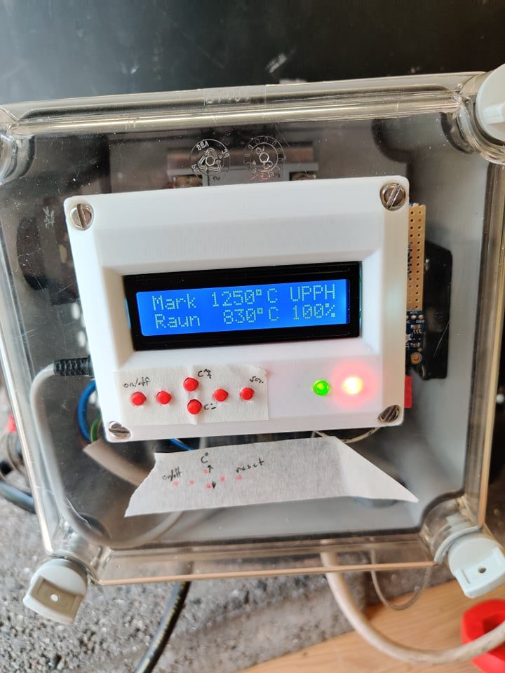
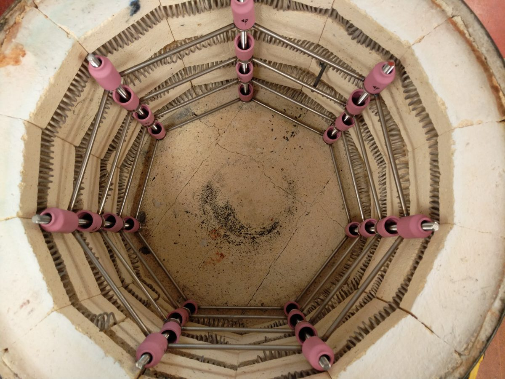

# Ceramic kiln controller

**Date:** 2021, code updated 2024

## Overview

We got an old ceramic kiln cheap because its controller was broken. This
project is the new controller we built for it: an Arduino, a thermocouple, a
solid state relay and a small display, all in one box next to the kiln.

!!! danger "Mains voltage"
    The controller switches the kiln's 230 V heating elements. Only work on
    the wiring with the power disconnected, and have the build checked by
    someone qualified before using it.

## Design

The wiring diagram shows how everything connects. The Arduino reads the
temperature from the thermocouple and switches the heating elements through
the solid state relay. A 12 V power supply runs the Arduino and a cooling fan
for the box.

## Materials and equipment

| Part | Notes |
| --- | --- |
| Arduino Uno | Runs the controller |
| Thermocouple with MAX31850 board | Reads the kiln temperature over 1-Wire |
| Solid state relay | Switches the heating elements |
| 16×2 LCD display | Shows target and actual temperature |
| Push buttons | Element on/off, temperature up and down, reset |
| Red and green LEDs | Red: element on. Green: power on |
| 12 V DC power supply | Powers the Arduino and the fan |
| Box cooling fan | Keeps the electronics cool |
| Power switch and terminal block | Mains side |
| Clear electrical enclosure | Holds everything |

The display frame and buttons are 3D printed. The STL files are in the
[original repository](https://github.com/FabLabIsafjordur/ceramic_klin_controler).

## Control panel

The display shows the target temperature on the top line and the actual
temperature on the bottom line. The labels are in Icelandic: **Mark** is the
target and **Raun** is the actual temperature.

## Element support frame

A support frame made from steel rods, with ceramic gas nozzles as spacers,
keeps the heating elements in place.

## Code

There are two versions of the code in the repository:

- `hitastyringv0.3.ino` controls the kiln to a target temperature set with
  the buttons, between 20 and 1250 °C.
- `keramik_styring.ino` (2024) runs a fixed firing schedule:
    1. Ramp to 300 °C and hold for 4 hours
    2. Ramp to 600 °C and hold for 3 hours
    3. Ramp to the saved target temperature, then turn off

Both versions can use PID control or simple on/off control.

## Files and resources

- [Original repository](https://github.com/FabLabIsafjordur/ceramic_klin_controler):
  code, wiring diagram (SVG) and STL files
