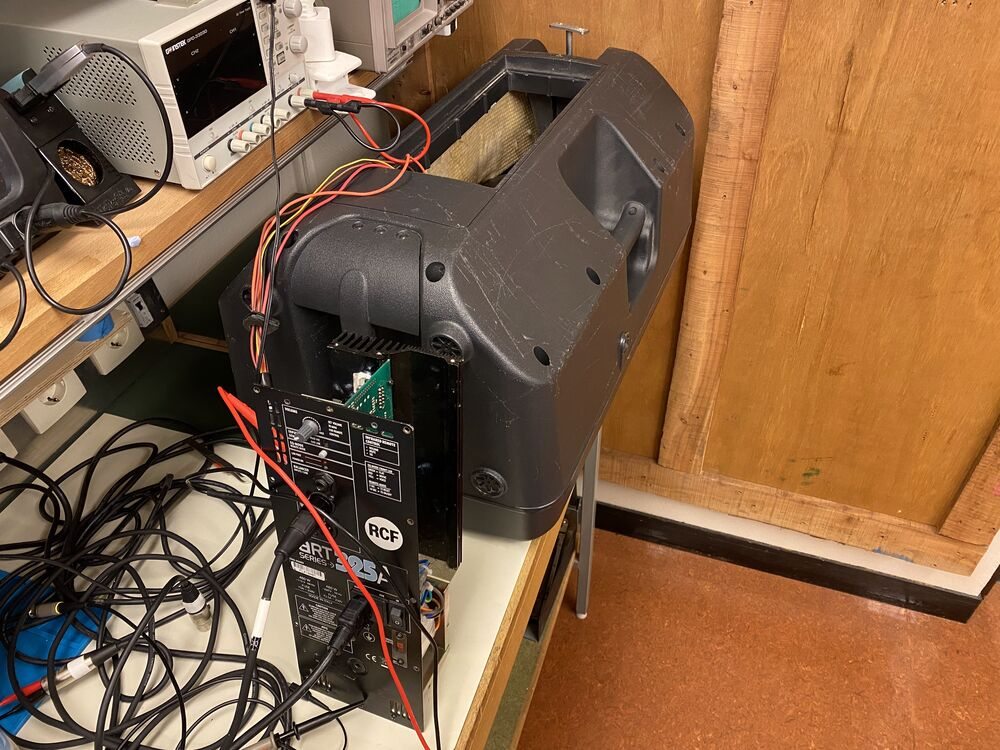
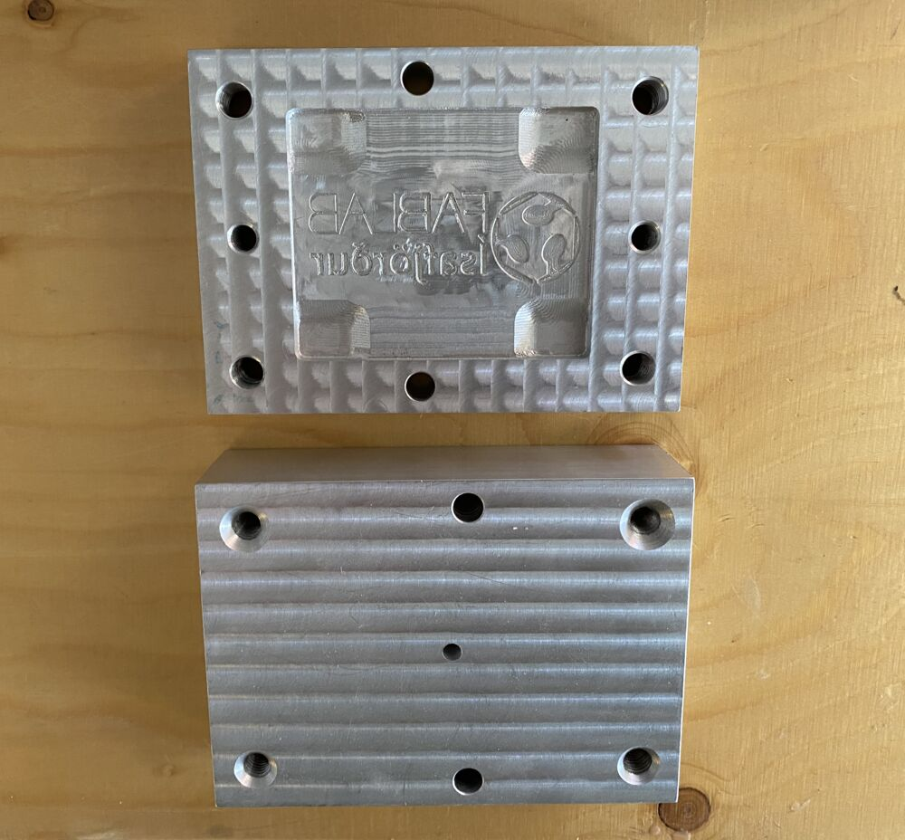

# System integration tips

**Author:** Svavar Konradsson  
**Date:** 2024-05-15

Here are a few tips that might be useful for
[System integration week](http://academy.cba.mit.edu/classes/system_integration/index.html)
in the [Fab Academy](https://fabacademy.org/).

## Nice prototyping

[Quote](https://makezine.com/article/digital-fabrication/machining/18-lessons-smart-prototyping-self-made-billionaire/)
from Dan Gelbart:

> I cannot overemphasise the importance of making everything with keyholes
> and slots and captive hardware. If you spend all your life in R&D you'll
> spend about one year of your life taking screws out of covers, so if you do
> it in slots, it's the same as extending your life by the same amount of
> health food plus exercise extends your life, and it's much simpler.

Dan Gelbart's classic notes on quick prototyping:
[Part 1](https://people.ece.ubc.ca/leos/pdf/tools/machine/DGCourseNotes.pdf),
[Part 2](https://people.ece.ubc.ca/leos/pdf/tools/machine/DGCourseNotes2.pdf)

Dan says that you can prototype just about anything with a
[waterjet cutter](https://wazer.com/) (because it cuts through any material
with good precision), a [press brake](https://en.wikipedia.org/wiki/Press_brake)
and some welding tools. Take a look at the examples in his notes, they're
fantastic.

## Packaging

A nice example of the importance of packaging. Virtual detents were
[developed by Jesse Schoch](https://youtu.be/1gPQfDkX3BU?t=859):

<video autoplay loop muted playsinline src="../img/system-integration-tips/virtual-detents.mp4" width="500"></video>

But the method didn't become popular until it was packaged as the
[SmartKnob by Scott Bezek](https://youtu.be/ip641WmY4pA):

<video autoplay loop muted playsinline src="../img/system-integration-tips/smartknob-detents.mp4" width="500"></video>

[Árni Björnsson](https://fabacademy.org/2022/labs/isafjordur/students/arni-bjornsson/)'s
final project reveals everything with a transparent enclosure:

{ width="500" }

Wires hidden inside the structure of an LED-studded dress and integrated
button, by [Hafey Hallgrímsdóttir](https://fabacademy.org/2023/labs/isafjordur/students/hafey-hallgrimsdottir/):

[The work that comes after the first rough prototype](https://youtu.be/caYl8u7Gd0A)

## Food projects

[Food safe design principles](https://www.meatinstitute.org/sites/default/files/original%20documents/Sanitation%20booklet%202021.pdf):

- Inert materials
- Simple shapes that are easy to clean
- Smooth surface finish
- No crevices where water collects and bacteria can grow

## Design for safety

A colleague at an Icelandic company put two buttons far apart on a silicone
molding press. The operator needs to push the buttons with both hands to
operate the press, to eliminate the chance of getting their hand crushed.

*Image from [OSHA](https://www.osha.gov/etools/machine-guarding/presses/two-hand-controls#mod1)*

## Usability

- A QR code on the device that points to the documentation can be a nice touch.
- Design 3D printed enclosures with [shadow lines](https://youtu.be/8dhFhU7Nl_0)
  like they do for injection molding.
- Would the device benefit from a small battery or capacitor to keep the
  clock running while it's not connected to power?

## Cable management

[Svavar](https://fabacademy.org/2023/labs/isafjordur/students/svavar-konradsson/)
demonstrates how you can embed mesh fabric into 3D prints and
[make a cable carrier](https://fab.cba.mit.edu/classes/865.24/people/svavar/components/cable_carrier/):

<video autoplay loop muted playsinline src="https://fab.cba.mit.edu/classes/865.24/people/svavar/components/images/cable_carrier/cable_carrier.mp4" width="500"></video>

Links from [Cedric Honnet](https://honnet.github.io/): "Cables can be
protected by [articulated](https://www.amazon.com/Plastic-Machine-Carrier-Ted-Lele/dp/B074S2GQ56/),
[braided](https://www.amazon.com/Keco-100ft-Expandable-Braided-Sleeving/dp/B07K1WP871)
or [hybrid wrappers](https://www.amazon.com/Management-Diameter-Organizer-Expandable-Concealer/dp/B07PPR47ZV/)."

[Vineet Padia](https://vineetpadia.github.io/about.html) has mentioned
[a way to document wiring harnesses](https://github.com/wireviz/WireViz).

It's good for students to know that
[pogo pins](https://youtube.com/shorts/ujPLo5TwJpo) and
[slip rings](https://www.electrical4u.com/slip-ring/) exist.

## Design for repair

The amplifier unit in this PA speaker has a generous cable length, so
[Þórarinn](https://fabacademy.org/archives/2015/eu/students/gunnarsson.thorarinn_b.b/index.html)
could pop it out and troubleshoot:

{ width="500" }

- [Right to repair](https://en.wikipedia.org/wiki/Right_to_repair)
- [Repair Café](https://www.repaircafe.org/en/). We host those at Fab Lab
  Ísafjörður. The atmosphere is great and it boosts community engagement with
  the lab.

## Assembly

Asymmetrical hole placement, so that you can't assemble the wrong way:

{ width="500" }

*Injection mold designed and fabricated by [Jóhannes Andrésson](https://www.linkedin.com/in/johannes-weber/).*

Preload things to eliminate rattle, for example with spring washers.

- [Automotive buzz, squeak and rattle book](https://www.amazon.com/Automotive-Buzz-Squeak-Rattle-Mechanisms-ebook/dp/B006NVY2VS)
- [Development of the Saab squeak and rattle design guidelines](http://www.diva-portal.org/smash/get/diva2:215325/FULLTEXT01.pdf)

## Documentation

Good ways to document electronics on a website:

- [InteractiveHtmlBom](https://github.com/openscopeproject/InteractiveHtmlBom)
- [KiCanvas](https://kicanvas.org/) (still in alpha, but you can
  [embed](https://kicanvas.org/embedding/) KiCad files on a web page)

## Files and resources

- [Original repository](https://github.com/FabLabIsafjordur/system-integration-tips) (CC0)
