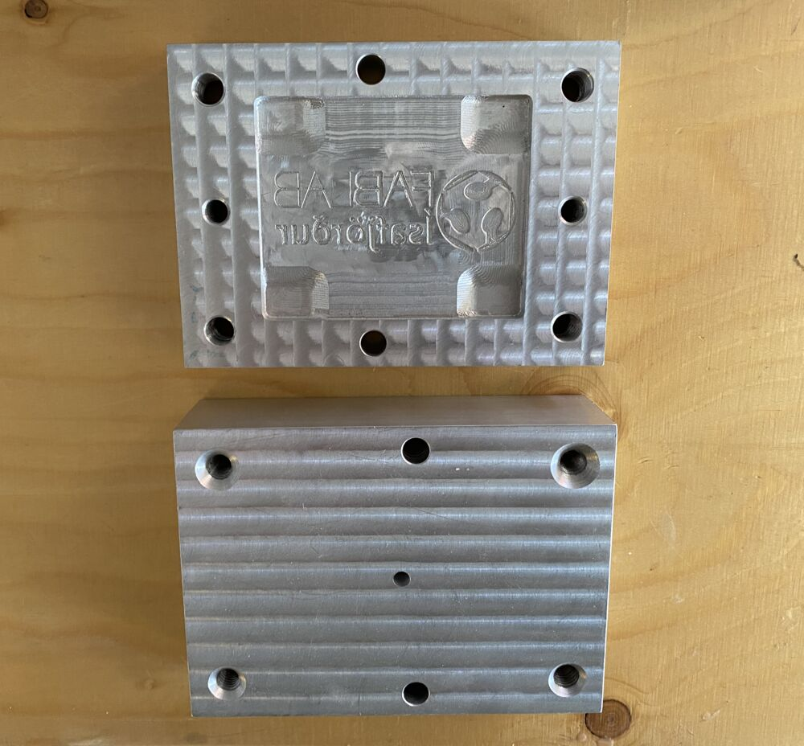

# Workshops

Teaching material from workshops, courses and classes at Fab Lab Ísafjörður,
including the Fab Academy and courses with local schools.

Use it to prepare for a class, follow along on your own, or reuse it in your
own teaching.

-   

    **[System integration tips](fab-academy/system-integration-tips.md)**

    Tips for Fab Academy system integration week: prototyping, packaging,
    safety, cables, repair and assembly.

Workshop material is grouped by course or topic, for example `fab-academy/`.
Images go in `img/<page-name>/`.
